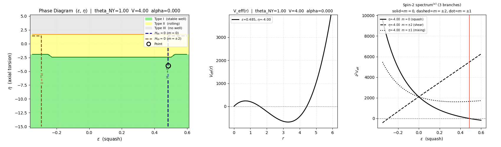
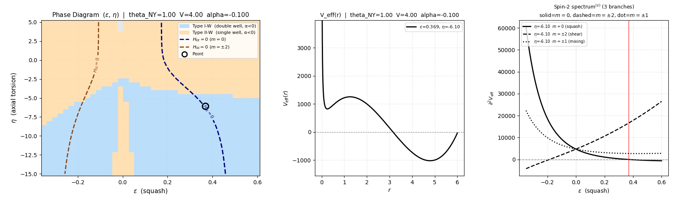
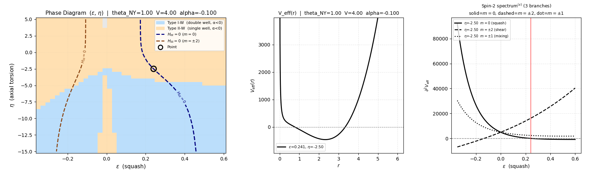
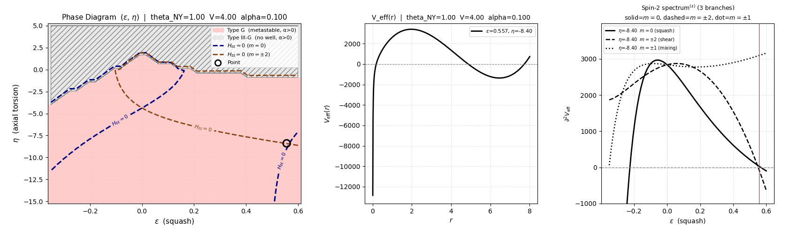

## Appendix H. Numerical Tables and Supplemental Data

本付録では、paper03 本文で繰り返し使う主要数値を一覧化する。

### H.1 Core numerical dictionary

| quantity | value | interpretation |
|---|---:|---|
| $r_0$ | 3.0 | 等方点半径 |
| $\mu_q^2$ | $48\pi^2 \approx 473.74$ | spin-2 quintet mass |
| $\varepsilon_{c+}$ | 0.48324 | positive-side softening threshold |
| $\varepsilon_{c-}$ | $-0.29309\pm0.00019$ | negative-side second-order transition |
| $\mu_\omega^2$ | 52.6379 | raw twist Hessian |
| $\mu_\delta^2$ | 3789.9295 | raw mixing Hessian |
| $m_{\omega\delta}$ | -631.6544 | raw bilinear mixing |
| $G_{\omega\omega}$ | 236.870435 | raw kinetic metric |
| $G_{\delta\delta}$ | 532.958162 | raw kinetic metric |
| $G_{\omega\delta}$ | -355.305547 | raw kinetic metric |
| $H_{\rm phys}$ | 3223.06 | physical spin-1 Hessian |
| $G_{\rm phys}$ | 769.8286 | physical spin-1 kinetic metric |
| $\lambda_{\rm phys}$ | 4.1867 | physical generalized eigenvalue |
| $H_{\rm null}$ | 894.845 | auxiliary curvature |
| $c_\omega$ | 105.28 | $h\omega\omega$ cubic coupling |
| $c_\delta$ | 1894.96 | $h\delta\delta$ cubic coupling |

### H.2 Cross-Hessian summary

| block | number of components | result |
|---|---:|---|
| spin-1 x spin-2 | 15 | all zero |
| spin-1 x radial | 3 | all zero |
| spin-1 x torsion | 3 | all zero |
| spin-2 x torsion ($\eta$ and $V$) | 10 | all zero |
| radial x $V$ | 1 | all zero |
| radial x $\eta$ | 1 | nonzero ($\approx 118.4$) |

| summary | result |
|---|---|
| quadratic structure | spin-1 fully decoupled; spin-2 decoupled from torsion; scalar/torsion subsector contains a coupled $(r,\eta)$ block |

### H.2A. Supplemental scalar-modulus check with $L$ released

paper03 本文では $S^3 \times S^1$ の $S^1$ スケール $L$ を $L=1$ に規格化して固定している。本節では $L$ を一時的に解放し、等方点近傍での 4×4 ヘッシアン $H^{(r,L,\eta,V)}$ を数値評価した結果を補助的に記録する。

#### 計算条件:
$r_0=3$, $L_0=1$, $\kappa=1$, $\alpha=\theta_{NY}=0$、中心差分 $h=10^{-3}$（複数ステップ幅で安定性確認済み）。

| background | $H_{LL}$ | $H_{rL}$ | $H_{L\eta}$ | $H_{LV}$ | $\lambda_{\min}$ |
|---|---:|---:|---:|---:|---:|
| AX | $\approx 0$ | -177.65 | 355.31 | 0 | -349.79 |
| VT | $\approx 0$ | -59.22 | 0 | 355.31 | -360.20 |
| MX | $\approx 0$ | $\approx 0$ | 355.31 | 355.31 | -437.45 |

なお、4×4 固有値は以下のようにいずれも indefinite（鞍点型）である。 

- AX: -349.8, 130.1, 355.3, 575.0
- VT: -360.2, 121.4, 355.3, 712.6
- MX: -437.5, 23.7, 412.0, 830.9

#### $L=1$ 固定の妥当性: 
$H_{LL} \approx 0$ であり $L$ は等方点で実効ポテンシャルの二次近似で平坦である。 $r$ と同様に $V_{\rm eff}$ によっては安定化されないため、本論での $L$ 固定（規格化）は適切である。

#### 既存 $(r,\eta,V)$ 構造の保存:
AX 背景での $H_{LV} \approx 0$（ $L$- $V$ 非結合）が確認され、 $V$ 方向の独立性は $L$ 解放後も保たれる。 $\eta$ 方向の正の固有値（ $\lambda \approx 355$ – $575$ ）も全モードで維持される。

#### $L$ の性格:
$L$ は安定な質量を持つ通常の scalar 自由度ではなく、 $r$ および $\eta$ と対角スケールと同程度の大きな混合結合（ $|H_{rL}|=177.6$ , $H_{L\eta}=355.3$ ）を持つ modulus 的な補助自由度である。 $L$ の解放は既存の鞍点構造をさらに深化させる（ $\lambda_{\min}$ は $(r,\eta)$ 2×2 の $-35.9$ から 4×4 では $-349.8$ へ）。

以上より、最終モード辞書（H.3）に $L$ は追加しない。 $L$ の取り扱いと安定化の可否については、本論文の範囲を超える別途解析課題として留保する。

### H.3 Final mode dictionary with numerical anchors

| variable | classification | numerical anchor | note |
|---|---|---|---|
| $q_A$ | spin-2 | $\mu_q^2=48\pi^2$ at $\varepsilon=0$ | final basis |
| $X_k$ | spin-1 physical | $\lambda_{\rm phys}=4.1867$ | quadratic decoupled |
| $Y_k$ | spin-1 auxiliary | $G\,Y_k=0,\ H_{\rm null}=894.845$ | not gauge |
| $\eta$ | torsion scalar | AX control parameter | physical input |
| $V$ | torsion scalar | VT control parameter | physical input |
| $P$ | topological density | AX / VT zero, MX nonzero | chirality indicator |

等方 MX 点において torsion scalar block は数値的に

$$
H^{(\eta,V)}=
\begin{pmatrix}
355.31 & 0 \\
0 & 355.31
\end{pmatrix}
$$

を満たす（数値確認）。radial mode との coupling を考慮する前の段階では、torsion subsector は局所的に安定かつ 2 重縮退している。

**$(r,\eta)$ 連立ブロックの固有値解析**（AX モード, $\eta=1, V=0$）

$$
H^{(r,\eta)}=
\begin{pmatrix}
H_{rr} & H_{r\eta} \\
H_{\eta r} & H_{\eta\eta}
\end{pmatrix}=
\begin{pmatrix}
\approx 0 & 118.44 \\
118.44 & 355.31
\end{pmatrix}
$$

| 量 | 値 |
|---|---:|
| $H_{rr}$ | $\approx 0$（ $-10^{-6}$ ） |
| $H_{r\eta}$ | $118.435$ |
| $H_{\eta\eta}$ | $355.306$ |
| $\det H^{(r,\eta)}$ | $-1.40 \times 10^4$ |
| $\lambda_1$（最小） | $-35.86$ |
| $\lambda_2$（最大） | $391.17$ |

$H_{rr} \approx 0$ は AX 背景において $r$ が実効ポテンシャルの **平坦方向（零モード）** であることを示す。その結果、 $\det H^{(r,\eta)} < 0$ となり、2×2 ブロックは鞍点型（indefinite）になる。負の固有値方向の固有ベクトルは主に $r$ 成分（ $\approx -0.957$ の $r$ + $0.290$ の $\eta$）であり、不安定性は $r$ の平坦方向と $r$- $\eta$ 結合の組み合わせに起因する。 $\eta$ 主成分方向の固有値 $\lambda_2 \approx 391$ は正定値を保つ。

モード比較では、VT モード（ $\eta=0, V=1$ ）では $H_{rr} = 118.44$（非ゼロ）かつ $H_{r\eta} \approx 0$ となり正定値ブロックを形成する。すなわち $r$- $\eta$ 混合と $r$ 零モードは axial torsion 成分（ $\eta$ ）に特有の現象である。

### H.4 Representative phase atlas on the axisymmetric slice

spin-2 branch tracking の代表値を、軸対称 slice $s=0$ で並べると次のようになる。

| $\varepsilon$ | $\mu^2_{m=0}=\mu^2_\varepsilon$ | $\mu^2_{m=\pm2}=\mu^2_s$ | $\mu^2_{m=\pm1}=\mu^2_\delta$ | phase note |
|---|---:|---:|---:|---|
| $-0.40$ | 675.1 | -239.8 | 117.4 | $m=\pm2$ branch unstable |
| $-0.30$ | 793.9 | -12.5 | 321.8 | near $\varepsilon_{c-}$ |
| $-0.20$ | 734.5 | 203.9 | 445.9 | stable negative side |
| $-0.10$ | 610.9 | 364.1 | 487.1 | stable negative side |
| $0.00$ | 473.7 | 473.7 | 473.7 | isotropic Schur point |
| $0.20$ | 219.8 | 685.1 | 413.3 | positive-side split |
| $0.40$ | 44.9 | 842.2 | 359.8 | near $\varepsilon_{c+}$ |
| $0.482$ | 0.49 | 891.8 | 341.6 | $m=0$ soft mode |

境界点だけを抜き出せば

| boundary | value | vanishing branch |
|---|---:|---|
| $\varepsilon_{c-}$ | $-0.29309\pm0.00019$ | $\mu^2_{m=\pm2}\to0$ |
| $\varepsilon_{c+}$ | $0.48324$ | $\mu^2_{m=0}\to0$ |

である。

### H.5 Composite visualization at selected $H_{\varepsilon\varepsilon}=0$ points

本節では、以下を同一図内に並べた補助可視化を示す。

(i) $(\varepsilon,\eta)$ 相図、  
(ii) 相図上で選んだ点での有効ポテンシャル $V_{\rm eff}(r)$、  
(iii) spin-2 スペクトルの 3 枝 $\{m=0,\ m=\pm2,\ m=\pm1\}$  

この可視化の目的は、本文 §4 および Appendix D で整理した spin-2 分裂と soft-mode 構造を、相図上の位置・ポテンシャル形状・分裂枝の対応として一望できるようにすることである。本文では、正の $\varepsilon$ 側では $m=0$ singlet が最初に soft となり、負の $\varepsilon$ 側では $m=\pm2$ sector が $s\neq0$ 相転移を支配することを示した。 本節の図は、その解析結果を補助的に可視化したものであり、Appendix D の解析式や §4 の遷移判定そのものを置き換えるものではない。

各図は 3 パネルから構成される。

- **左パネル**: $(\varepsilon,\eta)$ 相図。破線は $H_{\varepsilon\varepsilon}=0$ および $H_{ss}=0$ 軌跡、黒丸は選択した代表点を表す。
- **中央パネル**: その代表点における $V_{\rm eff}(r)$。
- **右パネル**: spin-2 スペクトルの 3 枝。実線が $m=0$、破線が $m=\pm2$、点線が $m=\pm1$ を表し、赤い縦線は左パネルで選んだ $\varepsilon$ の位置を示す。

ここで注意すべき点として、 $H_{\varepsilon\varepsilon}=0$ は **squash 方向に沿った局所的 softening 条件** であり、常に「相転移点そのもの」を与えるわけではない。とくに正の $\varepsilon$ 側では、本文 §4.4 で示したように、 $m=0$ singlet の softening はしきい値 $\varepsilon_{c+}$ を与えるが、その時点で直ちに新しい full condensed phase が出現するわけではない。
一方、 $H_{ss}=0$ は、本文 §4.5 の three-indicator 解析により、実際の $s\neq0$ 相転移は $m=\pm2$ sector に支配された 2 次相転移として位置づけられている。

#### Representative cases

本論文では、以下の 4 例を代表図として掲載する。

##### $\alpha=0$, Type-I representative point  
基準的な softening 図。本文で与えた正側しきい値 $\varepsilon_{c+}=0.48324$ に対応し、 $m=0$ 枝がちょうどゼロに達する一方、 $m=\pm2$ 枝はなお massive のままである。これは本文 §4.4 の “first soft mode” を図式的に再確認する。また、負側相転移においては、 $m=\pm2$ 枝が主役であることが視覚的に理解できる。これは本文 §4.5 の結論、すなわち負側では $s\neq0$ 相転移が $m=\pm2$ sector により支配されるという構図と整合的である。
   
   **Fig. 16** Composite visualization at a selected positive- $\varepsilon$, $\alpha=0$ point on the $H_{\varepsilon\varepsilon}=0$ locus.

##### $\alpha<0$, Type-IW / IIW representative point
$\alpha<0$ 側での局所 softening の例。paper02 より、 $\alpha\le0$ は等方真空の安定側として整理され、Type-IW、Type-IIW の安定相を形成する。よって、ここで見えるスペクトル分裂は ghost 不安定性ではなく、背景点の移動に伴う通常の枝分裂として解釈すべきである。

**Fig. 17** Composite visualization Type-IW at a positive- $\varepsilon$, $\alpha<0$ representative point on the $H_{\varepsilon\varepsilon}=0$ locus. 

**Fig. 18** Composite visualization Type-IIW at a positive- $\varepsilon$, $\alpha<0$ representative point on the $H_{\varepsilon\varepsilon}=0$ locus. 

以上の図は、相図上の点の「相分類」、その点での「半径方向ポテンシャルの形」、および「spin-2 分裂のどの枝が softening に関与するか」を、同一視野で比較するための補助 atlas として機能する。paper01 では可視化系そのものを独立の補助ツールとして整理し、paper02 では phase atlas を付録として与えたが、paper03 ではそれらを踏まえ、spin-2 sector の読図補助に特化した最小限の atlas として本節を位置づける。

#### $\alpha>0$, Type-G representative point について
ghost/metastable 側についても補助的な可視化は可能であるが、分裂枝の物理的解釈には注意を要する。
本論では、 $\alpha>0$ かつポテンシャルが局所井戸を持ちうる領域を相図上で Type-G と分類している。この領域は、大域的には安定真空を与えない ghost 不安定側に対応する [6]。
したがって、Type-G 領域における $H_{\varepsilon\varepsilon}=0$ および $H_{ss}=0$ は、安定相における臨界条件と同列には解釈されず、その詳細な物理的意味づけは本論の範囲外である。

**Fig. 19** Composite visualization at a positive- $\varepsilon$, $\alpha>0$ representative point. 

### H.6 Scripts

本付録の数値表を生成するスクリプトは以下の通りである。

- `paper03/spin0_torsion_cross_hessian.py`：spin-2 × torsion、radial × torsion の cross-Hessian、torsion block $H^{(\eta,V)}$（H.2 対応）
- `paper03/spin0_reta_block_eigenvalues.py`：$(r,\eta)$ 連立ブロックの固有値解析（H.3 対応）
- `paper03/spin0_rLetaV_hessian.py`：4×4 Hessian $H^{(r,L,\eta,V)}$（H.2A 対応）

### H.7 Remarks

本付録の数値は、本文での安定性議論と辞書表のための参照値である。ここでの phase atlas は代表点のみを抜粋したものであり、全グリッドの補助データや図版用の高密度表は必要に応じて後続稿または supplemental material に回す。
