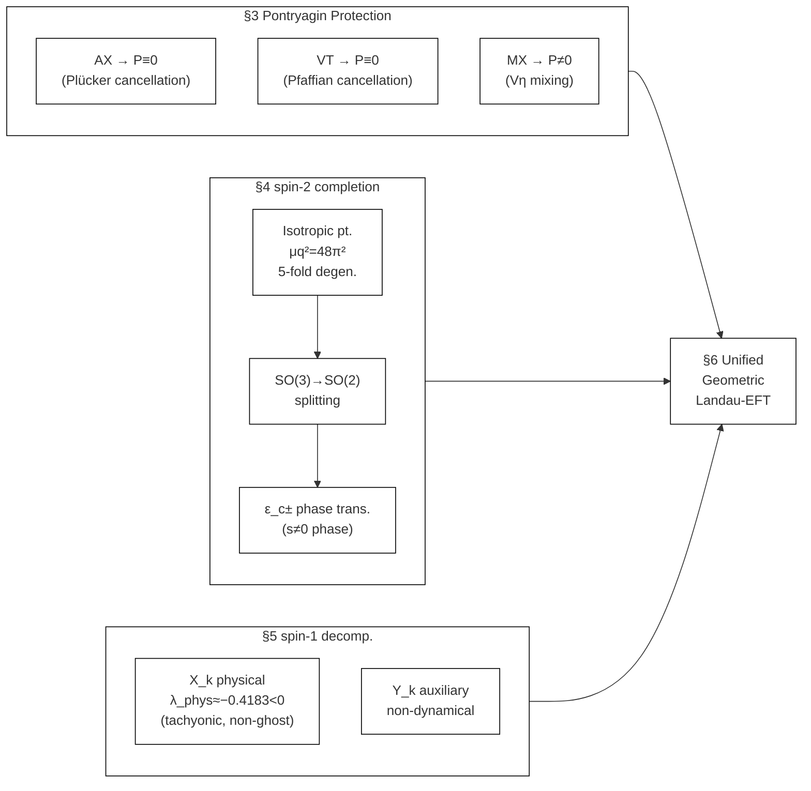

# Unified Geometric Landau EFT of Homogeneous $S^3 \times S^1$ Minisuperspace in Einstein-Cartan + Nieh-Yan Theory
一様 $S^3 \times S^1$ minisuperspace の統一幾何学的 Landau-EFT

## Abstract

本論文では、Einstein-Cartan （EC）重力に Nieh-Yan （NY）項を加えた理論の homogeneous $S^3\times S^1$ minisuperspace 還元を再構成し、その一様幾何セクターが有限自由度の幾何学的 Landau 有効理論として統一的に記述できることを示す。目的は、Pontryagin 保護構造、spin-2 shear 変形、spin-1 twist-mixing 系を、spin-0 / spin-2 / spin-1 の既約モードに沿って最終的に整理し直すことである。

まず、Pontryagin 密度 $P=\langle R,\star R\rangle$ に対して、AX および VT torsion mode では $P\equiv0$ が厳密に成立し、MX mode のみが $P\neq0$ を担うことを示す。とくに MX mode では

$$
P_0=\frac{2V\eta\,(V^2r^2+9\eta^2-36)}{9r^3}
$$

が等方点での生成源となり、Pontryagin 非零は twist 自身ではなく torsion 混合 $V\eta$ に起因する。

次に、full shear tensor を traceless symmetric tensor $h_{ij}$ として導入し、その 5 成分を spin-2 五重項 $q_A$ として整理する。等方点では Schur の補題により spin-2 Hessian は

$$
H_{AB}=\mu_q^2\,\delta_{AB},\qquad \mu_q^2=48\pi^2
$$

に五重縮退する。squash 背景では $SO(3)\to SO(2)$ の分裂が起こり、正の $\varepsilon$ 側では $m=0$ singlet が first soft mode となって $\varepsilon_{c+}=0.48324$ に達する一方、負の $\varepsilon$ 側では $m=\pm2$ sector が $\varepsilon_{c-}=-0.29309\pm0.00019$ で $s\neq0$ 相への 2 次相転移を起こす。

さらに、spin-1 セクターでは raw 変数 $(\omega_i,\delta_i)$ の Hessian と field-space metric を一般化固有値問題

$$
Hv=\lambda Gv
$$

として解析する。field-space metric は rank-deficient であり、null direction

$$
Y_k\propto\left(1,\frac{2L}{r_0}\right)
$$

は gauge でも variable redundancy でもなく、non-dynamical auxiliary 方向として解釈される。physical spin-1 mode は

$$
X_k=\frac{-2\omega_k+3\delta_k}{\sqrt{13}}
$$

で与えられる。second-class auxiliary $Y_k$ を Schur 消去した有限一般化固有値は $\lambda_{\rm phys}\simeq -0.4183<0$ であり、対応する kinetic norm は正である。したがって physical spin-1 triplet は非ゴースト・タキオン的である。一方、mixed Hessian 計算により、この corrected spin-1 mode は二次レベルで spin-2、radial、torsion 各 sector と完全に decouple する。

以上を総合すると、本モデルは homogeneous $S^3\times S^1$ 幾何を舞台とする統一的な geometric Landau-EFT として理解できる。ここでは一様幾何自由度が既約表現に沿って整理され、Pontryagin 保護、相転移方向、physical/auxiliary 分解、および許容される相互作用項が一つの理論枠組みに統合される。本論は、EC+NY における古典的 minisuperspace 幾何セクターの一つの閉じた枠組みを与え、量子化等、今後の拡張の基盤とすることができる。

---

## 1. Introduction

### 1.1 背景

paper01 では、Einstein-Cartan + Nieh-Yan minisuperspace の有効ポテンシャルを用いて、 $S^3\times S^1$、 $T^3\times S^1$、 $Nil^3\times S^1$ を共通の枠組みで比較し、等方的 $S^3\times S^1$ 真空の優位性が明らかになった [1]。paper02 では、その等方真空に対して Weyl 拡張と Pontryagin 構造を加え、位相的保護と力学的頑健性の両面から真空の安定性が整理された [2]。

残っていた課題は、一様幾何自由度全体を既約表現に沿って統一的に整理することであった。具体的には、

1. Pontryagin 密度がどの sector で真に生成されるのか。
2. squash / shear 変形を単なる補助的座標ではなく完全な spin-2 多重項として扱えるのか。
3. twist と mixing の 6 成分を、physical mode と non-dynamical auxiliary mode に一意に分解できるのか。
4. それらを最終的に一つの有効理論として束ねられるのか。

本論文は、この 4 点を一つの completed homogeneous geometric sector としてまとめ直すことを目的とする。

### 1.2 本論文の視点

本論で採用する基底を、まず明示する。幾何自由度は最終的に、以下のように再編成される。

- spin-0: radial mode $r$ と torsion scalars $(\eta,V)$
- spin-2: traceless symmetric quintet $q_A$
- spin-1: physical triplet $X_k$ と auxiliary triplet $Y_k$

paper02 で導入した単一 squash 変数 $\varepsilon$ や、本論で追加導入する単一 shear 変数 $s$ は、最終的には spin-2 五重項の一部として理解される [1,2]。

### 1.3 主要結果

本論の主要結果は以下の 5 点に集約される。

1. **Pontryagin 保護定理**: AX / VT mode では $P\equiv0$ が厳密に成立し、MX mode のみが $P\neq0$ を担う。
2. **spin-2 完備化**: full shear tensor は spin-2 五重項として完備され、等方点では $\mu_q^2=48\pi^2$ に五重縮退する。
3. **相図の最終整理**: 正側では $m=0$ singlet が $\varepsilon_{c+}=0.48324$ で softening し、負側では $\varepsilon_{c-}=-0.29309\pm0.00019$ で $s\neq0$ 相への 2 次相転移が起こる。
4. **spin-1 physical/auxiliary 分解**: $Y_k$ は gauge でも redundancy でもなく non-dynamical auxiliary であり、 $X_k=(-2\omega_k+3\delta_k)/\sqrt{13}$ が唯一の propagating spin-1 basis を与える。
5. **統一 Landau-EFT**: final basis では二次 sector が block-diagonal 化され、許容 cubic coupling と禁制項が表現論的に整理される。

### 1.4 本論文の構成

本論文の構成は次の通りである。

- §2 では作用、homogeneous ansatz、最終採用変数を定義する。
- §3 では Pontryagin 保護定理と MX 例外を示す。
- §4 では full shear quintet、SO(2) 分裂、相転移構造を論じる。
- §5 では spin-1 セクターを generalized eigenvalue problem として再構成し、physical / auxiliary 分解を確立する。
- §6 では最終 Landau-EFT と辞書表をまとめる。
- §7 では 一様幾何自由度で完結したことと、今後に持ち越される課題を整理する。
- §8 は結論である。
- Appendix A-I には、計算パイプライン、証明、mass splitting 公式、spin-1 Schur 消去、cross-Hessian 詳細、不変量基底、数値表、および reduction-order artifact 診断を収める。

**Fig. 1** Logical structure of this paper and connections between sections.

---

## 本文

- [§2. Setup and Geometric Framework](DPPUv2-paper03_sec02.md)
- [§3. Pontryagin Protection Structure](DPPUv2-paper03_sec03.md)
- [§4. Spin-2 Sector](DPPUv2-paper03_sec04.md)
- [§5. Spin-1 Sector](DPPUv2-paper03_sec05.md)
- [§6. Unified Geometric Landau EFT](DPPUv2-paper03_sec06.md)
- [§7. Physical Interpretation and Outlook](DPPUv2-paper03_sec07.md)
- [§8. Conclusion](DPPUv2-paper03_sec08.md)

## 付録

- [Appendix A. Conventions and Computational Pipeline](DPPUv2-paper03_appA.md)
- [Appendix B. Detailed Proof of the Pontryagin Protection Theorem](DPPUv2-paper03_appB.md)
- [Appendix C. Full Shear Tensor Basis and Embedding of $(\varepsilon,s,\phi)$](DPPUv2-paper03_appC.md)
- [Appendix D. Mass Splitting Formulae in the Spin-2 Sector](DPPUv2-paper03_appD.md)
- [Appendix E. Spin-1 Sector: Schur Reduction and Finite Generalized Eigenvalue](DPPUv2-paper03_appE.md)
- [Appendix F. Cross-Hessian Checks and Quadratic Decoupling](DPPUv2-paper03_appF.md)
- [Appendix G. Landau-EFT Selection Rules and Forbidden Terms](DPPUv2-paper03_appG.md)
- [Appendix H. Numerical Tables and Supplemental Data](DPPUv2-paper03_appH.md)
- [Appendix I. Reduction-order Artifact in the Spin-1 Sector](DPPUv2-paper03_appI.md)

## 参考文献

1. Muacca, "Topology-Dependent Phase Classification of Effective Potentials in Einstein–Cartan + Nieh–Yan Minisuperspace," Zenodo. 10.5281/zenodo.18213677 (2026).
2. Muacca, "Structural Robustness of Isotropic S³ Vacua in Einstein-Cartan Minisuperspace via Chiral Equilibrium and Weyl Stability," Zenodo. 10.5281/zenodo.18815498 (2026).
3. F. W. Hehl, P. von der Heyde, G. D. Kerlick, and J. M. Nester, "General relativity with spin and torsion: Foundations and prospects," Rev. Mod. Phys. **48**, 393–416 (1976).
4. H. T. Nieh and M. L. Yan, "An identity in Riemann–Cartan geometry," J. Math. Phys. **23**, 373–374 (1982).
5. O. Chandia and J. Zanelli, "Topological invariants, instantons, and the chiral anomaly on spaces with torsion," Phys. Rev. D **55**, 7580–7585 (1997).
6. R. P. Woodard,“Ostrogradsky's theorem on Hamiltonian instability,” Scholarpedia, 10(8), 32243 (2015).
