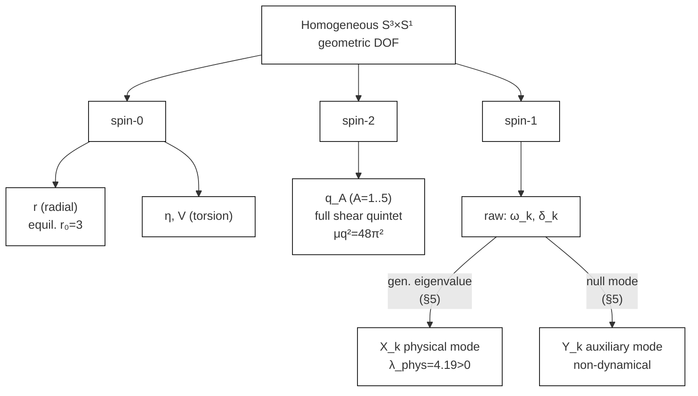

## 2. Setup and Geometric Framework

本節では、自由度、作用、幾何学的記法をまとめる。なお、最終的に採用する基底を標準形として用いる。

### 2.1 Effective potential

一様 minisuperspace 還元における有効ポテンシャルは

$$
V_{\rm eff}
= -\left(\frac{R}{2\kappa^2}+\theta_{\rm NY}N\right)\,{\rm Vol},
\qquad
{\rm Vol}=2\pi^2Lr^3
$$

で定義する。ここで $R$ は Einstein-Cartan 接続から計算される Ricci scalar [3]、 $N$ は Nieh-Yan 密度 [4]、 $r$ は $S^3$ 半径、 $L$ は $S^1$ 方向のスケールである。以後の等方点評価では $L=1$ に規格化し、そのときの平衡半径は $r_0=3$ である。

Pontryagin 密度は

$$
P=\langle R,\star R\rangle = \frac12\,\varepsilon^{abcd}R_{abef}R_{cd}{}^{ef}
$$

で定義する [5]。本論の主題は、 $V_{\rm eff}$ と $P$ を一様幾何自由度の最終基底で整理することである。

### 2.2 Homogeneous ansatz and spatial frame

空間 3-フレームは左不変 1-形式 $\sigma^i$ を用いて

$$
e^i=r\,M^{i}{}_j\,\sigma^j
$$

と書く。ここで $M^i{}_j=(\exp h)^i{}_j$（ $h=\sum_A q_A T_A$: full shear tensor, §2.3）であり、full shear 変形はこの一定 frame 変形として埋め込まれる。時間方向を含む完全なコフレーム（twist $\omega_k$ および spin-1 mixing $\delta_k$ の定義を含む）は App B.2.1 にまとめる。

一定 frame 変形の下で構造定数は

$$
C'^{i}{}_{jk} = M^{i}{}_a (M^{-1})^b{}_j (M^{-1})^c{}_k C^a{}_{bc}
$$

と変換し、homogeneous Maurer-Cartan 系は保たれる。

### 2.3 Spin-2 quintet: full shear basis

traceless symmetric tensor $h_{ij}$ を

$$
h_{ij}=\sum_{A=1}^5 q_A (T_A)_{ij},
\qquad
{\rm Tr}(T_AT_B)=\delta_{AB}
$$

と展開する。最終採用基底は

$$
T_1=\frac{1}{\sqrt6}
\begin{pmatrix}
1&0&0\\
0&1&0\\
0&0&-2
\end{pmatrix},
\quad
T_2=\frac{1}{\sqrt2}
\begin{pmatrix}
1&0&0\\
0&-1&0\\
0&0&0
\end{pmatrix},
$$

$$
T_3=\frac{1}{\sqrt2}
\begin{pmatrix}
0&1&0\\
1&0&0\\
0&0&0
\end{pmatrix},
\quad
T_4=\frac{1}{\sqrt2}
\begin{pmatrix}
0&0&1\\
0&0&0\\
1&0&0
\end{pmatrix},
\quad
T_5=\frac{1}{\sqrt2}
\begin{pmatrix}
0&0&0\\
0&0&1\\
0&1&0
\end{pmatrix}
$$

である。

この基底に対する基本不変量は

$$
I_2={\rm tr}(h^2)=\sum_{A=1}^5 q_A^2,
\qquad
I_3=h_{ij}\omega_i\omega_j,
\qquad
I_4={\rm tr}(h^3),
\qquad
W_2=\omega_i\omega_i
$$

である。厳密チェックにより、 $I_3=q_A F_A(\omega)$ の成分展開は最終 $T_A$ 規約の下で exact に成立する。

### 2.4 Spin-1 variables and torsion modes

spin-1 セクターの raw 幾何変数は twist $\omega_i$ と mixing $\delta_i$ である。ただし raw basis は最終的な physical basis ではない。一般化固有値解析（§5）により、raw 変数は physical propagating triplet $X_k$ と non-dynamical auxiliary $Y_k$ に分解される。各基底の明示的な式および導出は §5 を参照のこと。

torsion scalar については、最終的に

- AX mode: $(\eta\neq0,\;V=0)$
- VT mode: $(\eta=0,\;V\neq0)$
- MX mode: $(\eta\neq0,\;V\neq0)$

の 3 つを区別する。Pontryagin 構造に関しては、この区別が本質的である。

### 2.5 Representation-theoretic organisation

以上の自由度は $SO(3)$ 表現に沿って次のように整理される。

| sector | variable | DOF | representation |
|---|---|---:|---|
| radial | $r$ | 1 | spin-0 |
| shear | $q_A$ | 5 | spin-2 |
| raw twist/mixing | $(\omega_i,\delta_i)$ | 6 | spin-1 $\oplus$ spin-1 |
| physical spin-1 | $X_k$ | 3 | spin-1 |
| auxiliary spin-1 | $Y_k$ | 3 | spin-1 |
| torsion | $(\eta,V)$ | 2 | spin-0 |

この表が、本論全体で用いる mode dictionary の出発点である。とくに $\varepsilon$ や $s$ は最終的には $q_A$ の一部として読み替えられ、単独の既約変数としては扱わない。spin-1 の physical / auxiliary 判定は §5 の generalized eigenvalue 解析で確立し、確定版の辞書は §6.4 にまとめる。

**Fig. 2** SO(3) irreducible decomposition of homogeneous geometric DOF and final mode classification.

### 2.6 Scope

本論が扱うのは homogeneous minisuperspace の一様幾何 sector である。したがって、局所的な非一様モード、境界条件、full field-theoretic な gauge fixing は本論の対象外である。§7 で述べるように、これらは今後の課題である。
