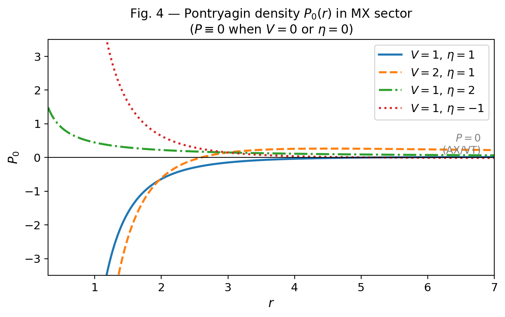
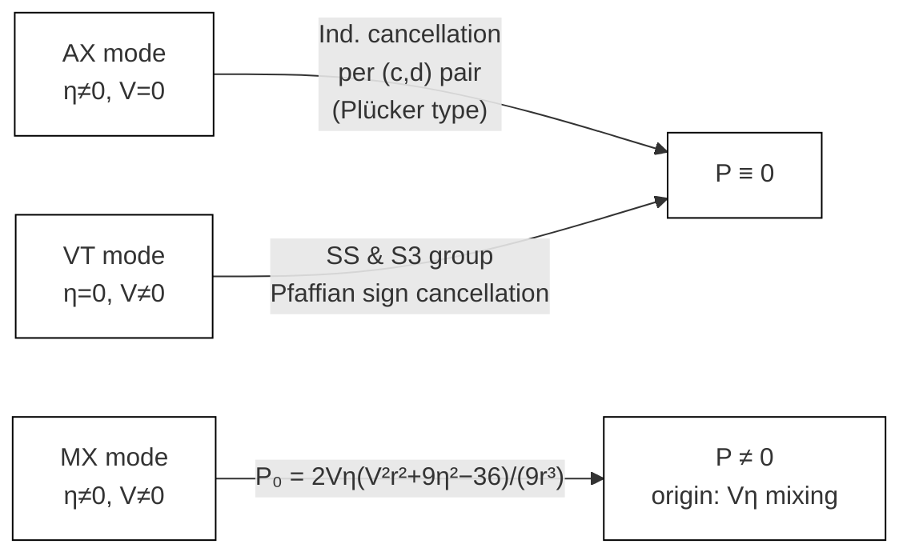

## 3. Pontryagin Protection Structure

本節の主張は単純である。Pontryagin 密度 $P$ は homogeneous sector のどこでも一般的に生じるわけではない。AX / VT mode では厳密に消え、MX mode のみが例外となる。この構造は、対称性による曖昧な議論ではなく、Riemann ブロックの代数的消去によって成立する。

### 3.1 Pontryagin density and block decomposition

Pontryagin 密度 $P=\langle R,\star R\rangle$ は §2.1 で定義済みである。3+1 的なブロック表示では

$$
P=\sum_{c \lt d}(R_{01cd}R_{23cd}-R_{02cd}R_{13cd}+R_{12cd}R_{03cd})
$$

となり、各 $(c,d)$ ごとの消去構造を追うことができる。

### 3.2 Theorem P0: AX / VT sectors

> **Theorem P0.**
> AX mode および VT mode では、 $S^3\times S^1$、 $Nil^3\times S^1$、 $T^3\times S^1$ の一般 vector twist ansatz に対して $P\equiv0$ が成立する。

$S^3$ と $Nil^3$ の等方 twist に対しては、各固定 $(c,d)$ で

$$
R_{01cd}R_{23cd}-R_{02cd}R_{13cd}+R_{12cd}R_{03cd}=0
$$

が個別に成立する。したがって

$$
P=\sum_{c \lt d}(R_{01cd}R_{23cd}-R_{02cd}R_{13cd}+R_{12cd}R_{03cd})=0.
$$

重要なのは、これが「和として偶然にゼロ」ではなく、各 $(c,d)$ 項の独立な消去である点である。さらに非等方 vector twist に対しても記号計算で $P\equiv0$ が確認されており、保護機構は等方性そのものには依存しない。

### 3.3 VT sector: Pfaffian cancellation

VT mode では、より精密には Pfaffian 群の相殺が起こる。

> **Lemma VT-Pfaffian.**
> VT mode では各 Riemann ブロック Pfaffian は個別には非零でも、SS 群と S3 群が等大逆符号で相殺し、全体として $P\equiv0$ となる。

$S^3\times S^1$ と $Nil^3\times S^1$ の両方でこの相殺が成立する。VT mode の保護は decomposable block の単純な自明化ではなく、Pfaffian 群同士の厳密相殺である。Pfaffian の具体式と両トポロジーの確認詳細は Appendix B.3 を参照のこと。

### 3.4 MX sector as the unique source of $P\neq0$

> **Proposition MX-P.**
> MX mode では Pontryagin 密度は torsion 混合 $V\eta$ に比例して生成され、twist 自身はその起源ではない。

$S^3\times S^1$ では

$$
P(\boldsymbol{\omega})=\underbrace{\frac{2V\eta\,(V^2r^2+9\eta^2-36)}{9r^3}}_{P_0=P(\omega=0)}+\underbrace{\frac{40V\eta L^2}{3r^5}}_{C_1}\,I_2.
$$

等方点ですでに

$$
P_0=\frac{2V\eta\,(V^2r^2+9\eta^2-36)}{9r^3}
$$

が残っており、Pontryagin 非零の起源は vacuum torsion mixing にある。したがって、MX mode における chirality 生成を twist の自発生成と同一視してはならない。

**Fig. 4** Pontryagin density $P$ in the MX sector as a function of the torsion mixing parameter $V\eta$. Non-zero $P$ arises exclusively from vacuum torsion mixing; the twist field $\omega$ itself is not the origin.

### 3.5 NyVariant independence and twist stability

Pontryagin 判定は Riemann テンソルの構造に依存するため、NyVariant（FULL / TT / REE）には依存しない。すなわち AX / VT では常に 0、MX では常に nonzero である。これを整理した表については Appendix B.5 に掲載する。

また、本論の対象領域では twist 自発生成も現れない。 $S^3\times S^1$ に対する等方 twist 有効ポテンシャルから

$$
m^2_{S^3}(r)=\left.\frac{\partial^2V_{\rm eff}}{\partial\omega^2}\right|_{\omega=0}=\frac{48\pi^2L^3}{\kappa^2r}>0
$$

となることから、 $\omega=0$ は全 $r>0$ で安定である [2]。

### 3.6 Interpretation

本節の結論は、Pontryagin 構造が「twist があるから非零になる」というものではなく、正確には次の 3 点で述べる通りである。

1. AX / VT では $P$ は構造的に保護される。
2. MX が唯一の例外であり、その起源は $V\eta$ 混合である [5]。
3. 本論の対象範囲では twist sector 自体は安定であり、自発的 twist 生成は起こらない。

この保護構造が、後に導入する spin-2 / spin-1 の整理と矛盾しないことが、本論文の統一的な出発点である。

**Fig. 3** Classification of Pontryagin density by torsion mode. AX/VT are protected by distinct algebraic mechanisms; MX is the unique exception.

