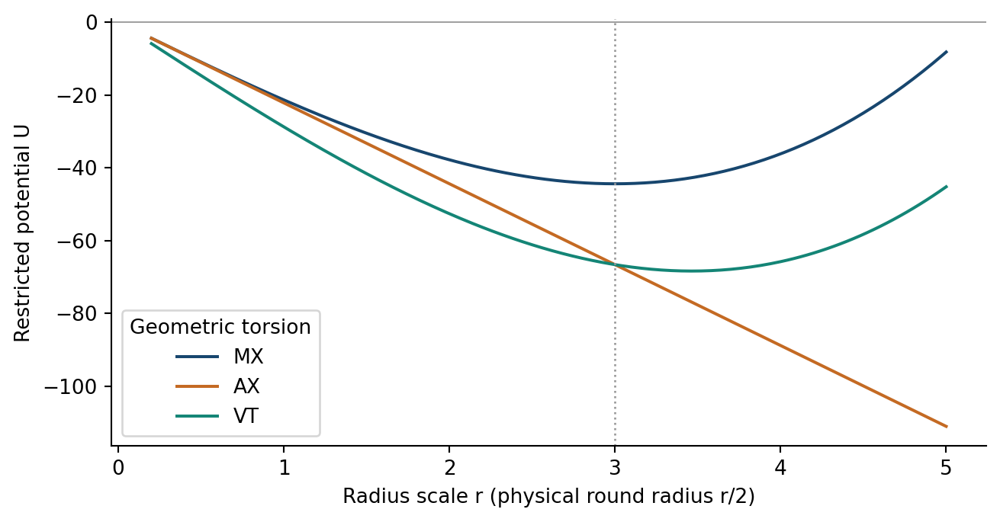
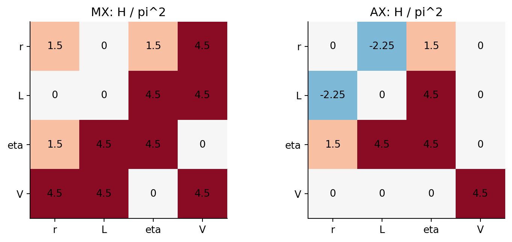

# 3. Spin-0：半径・torsion・円のscale

## 静的結合と半径極小

round形状、twistゼロでのスカラーポテンシャルは

式(S1)：

$$
U_0=\frac{\pi^2Lr}{12\kappa^2}(V^2r^2+9\eta^2-36).
$$

$L,\eta,V$ を固定したとき、正の半径での厳密な極小が存在する条件は $V\ne0$ かつ $\eta^2<4$ である。その位置と曲率は

式(S2)：

$$
r_{\ast}=\frac{\sqrt{12-3\eta^2}}{|V|},
\qquad U_{rr}(r_{\ast})=\frac{\pi^2LV^2r_{\ast}}{2\kappa^2}>0.
$$

$\eta=V=1$ では $r_{\ast}=3$ となる。 $V=0$ ではUはrに一次であり、 $\eta^2<4$ で減少、 $\eta^2=4$ で一定、 $\eta^2>4$ で増加する。 $V\ne0,\eta^2\ge4$ では正のrに対して増加し、内部極小を持たない。この分類により半径曲率ゼロと実際のflatなポテンシャルを区別できる。特にAX、 $\eta=1$ では $U_{rr}=0$ でも $U_r=-9\pi^2L/(4\kappa^2)$ である。

$L=\kappa=1$ 、有効なtorsion係数を1とした半径ポテンシャル。MXの極小は $r=3$ 、VTは $r=\sqrt{12}$ 、AXは一次関数である。

torsion座標の静的対角曲率は正である。半径との結合は背景によって異なる。

式(S3)：

$$
\begin{aligned}
U_{\eta\eta}&=\frac{3\pi^2Lr}{2\kappa^2},&
U_{VV}&=\frac{\pi^2Lr^3}{6\kappa^2},&
U_{\eta V}&=0,\\
U_{r\eta}&=\frac{3\pi^2L\eta}{2\kappa^2},&
U_{rV}&=\frac{\pi^2Lr^2V}{2\kappa^2}.
\end{aligned}
$$

従って $V=0$ のAX点ではVは $(r,\eta)$ から二次で分離するが、VT・MXではrと結合する。 $r=3$ での $U_{\eta\eta}=U_{VV}$ はこの座標での一致であり、 $SO(3)$ が強制する縮退ではない。Lを含めるとさらにスカラー交差項が現れる。付録Fに共通座標による勾配とHessianの全体を示す。

共通座標 $(r,L,\eta,V)$ におけるHessianを $\pi^2$ で割った値。 $\kappa=1$ 、MX点 $(3,1,1,1)$ とAX点 $(3,1,1,0)$ のスカラー変形間の結合を示す。

## 円方向のexactスカラー作用

round・twistゼロのcoframe上で、 $r,L>0$ を満たす滑らかな周期関数 $r(y),L(y),\eta(y),V(y)$ を許す。接続微分を含め、全微分を円上で積分すると、

式(S4)：

$$
\mathcal S_{\mathrm{scalar}}=
\int_0^1dy\left[U_0(r,L,\eta,V)
-\frac{3\pi^2}{4\kappa^2}\frac{r(r')^2}{L}\right].
$$

付録AでCartan曲率から直接導く。半径には円方向微分項があり、曲率中の $\eta',V'$ の寄与は全微分へまとまる。独立した $L'$ 項もbulkには残らない。ここでL(y)は局所lapse、 $\int_0^1L(y)dy$ は円周であり、L(y)の変分と円周固定は区別して指定する。半径微分項の負符号は、ここで定義したEuclidean作用における半径変分の性質である。lapseと拘束の標準的整理は [6] を参照。

スカラーセクターは、制御変数固定での半径ポテンシャル、制御変数を変えたときの静的応答、円方向の制限作用という段階に整理できる。例えばMXの半径極小では一つの微分が零になる一方、他のスカラー勾配は零とは限らない。これにより、半径の条件付き分類と、大きさ・torsion・円scaleの役割の違いを同時に記述できる。

一般作用では、誘導計量(M4)を通じてスカラー変化がshape・twistの微分と結合する。式(S4)でこれらの交叉項が消えるのは、round・twistゼロに制限しているためである。非零twistでのlapseはcoframe係数Lと異なる $\mathcal N$ であり、この座標に現れる $L'$ の交叉項を独立なlapse自由度と同定しない。

[前の節・付録](DPPUv2-paper03_sec02.md) / [次の節・付録](DPPUv2-paper03_sec04.md) / [第1節](DPPUv2-paper03_sec01.md)
