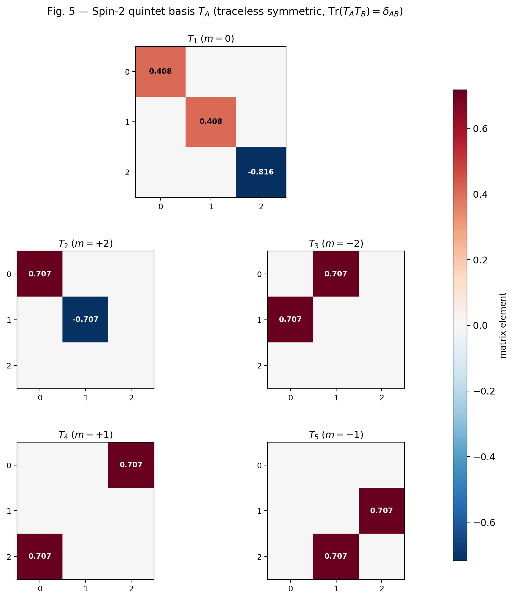
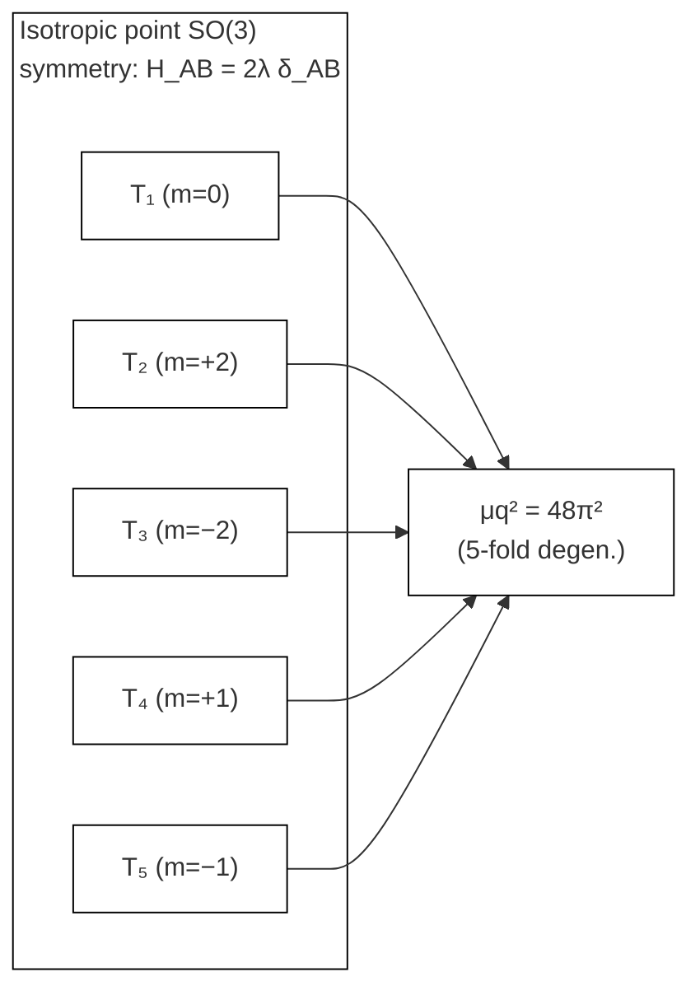
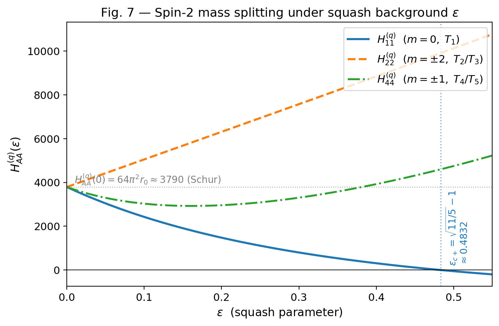
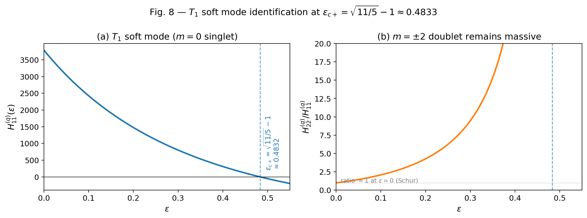
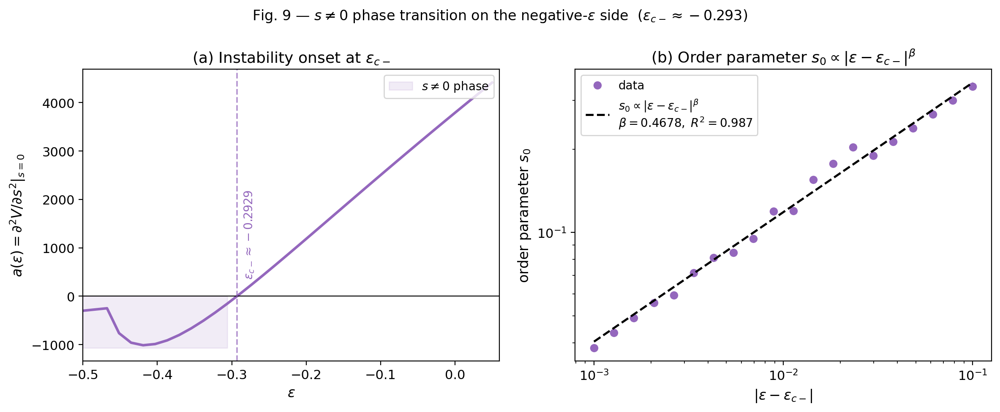

## 4. Spin-2 Sector: Full Shear Completion and Geometric Phase Structure

本節では、squash / shear 変形を full shear tensor として完備し、spin-2 五重項の相図を最終形で整理する。結論は、等方点では五重縮退、正側では $m=0$ singlet の softening、負側では $m=\pm2$ sector の連続相転移、である。

### 4.1 Full shear tensor as the spin-2 quintet

raw 幾何変数 $(\varepsilon,s,\phi)$ による記述は、特定の slice を追うには有効でも、spin-2 sector 全体を表すには不十分である。本論では

$$
h_{ij}=\sum_{A=1}^5 q_A (T_A)_{ij}
$$

を採用し、 $\mathrm{Sym}_0^2(\mathbb{R}^3)$ の 5 成分を完全な spin-2 quintet として扱う。ここで $q_A$ は SO(3) の既約基底に沿った最終変数であり、 $\varepsilon$ や $s$ はその特定方向への射影として用いる。

**Fig. 5** Basis vectors $T_1,\ldots,T_5$ of the spin-2 quintet $\mathrm{Sym}_0^2(\mathbb{R}^3)$. The three sectors correspond to the residual SO(2) representations $m=0$, $m=\pm2$, and $m=\pm1$.

### 4.2 Isotropic point and Schur degeneracy

等方点では residual symmetry が完全な SO(3) に戻るため、spin-2 Hessian は既約表現ごとに単位行列に比例する。すなわち

$$
V_{\rm eff}=V_0+\lambda\,{\rm tr}(h^2)+O(|q|^3)=V_0+\lambda\sum_{A=1}^5 q_A^2+O(|q|^3),
$$

ゆえに

$$
H_{AB}=\left.\frac{\partial^2V}{\partial q_A\partial q_B}\right|_0=2\lambda\,\delta_{AB}.
$$

これにより generalized mass は全 5 成分で等しく

$$
\mu_q^2=48\pi^2
$$

となる。これが spin-2 sector の最終的な Schur degeneracy である。

**Fig. 6** Five-fold degeneracy of the spin-2 quintet at the isotropic point. Schur's lemma $H_{AB}=2\lambda\delta_{AB}$ enforces equal mass for all 5 components.

### 4.3 SO(3) to SO(2) splitting under squash background

正側 squash 背景では $SO(3)\to SO(2)$ に分裂し、spin-2 quintet は

| residual charge | basis | interpretation |
|---|---|---|
| $m=0$ | $T_1$ | squash singlet |
| $m=\pm2$ | $(T_2,T_3)$ | in-plane doublet |
| $m=\pm1$ | $(T_4,T_5)$ | off-axis doublet |

に分かれる。ここで重要なのは、soft mode の出現順序がこの residual representation によって整理される点である。

**Fig. 7** Mass splitting of the spin-2 quintet as a function of the squash parameter $\varepsilon$. The three branches correspond to $m=0$ (singlet $T_1$), $m=\pm2$ (doublet $T_2,T_3$), and $m=\pm1$ (doublet $T_4,T_5$). The $m=0$ branch reaches zero first at $\varepsilon_{c+}$.

### 4.4 Positive- $\varepsilon$ side: first soft mode

full shear 解析の結果、正側では $T_1$ singlet が最初に soft となる。臨界値は

$$
\varepsilon_{c+}=0.48324,
\qquad
r_0(\varepsilon_{c+})=2.8114
$$

であり、この点で

$$
\mu_\varepsilon^2\to0
$$

となる。

**Fig. 8** Softening of the $m=0$ mode $\mu_\varepsilon^2(\varepsilon)$ on the positive- $\varepsilon$ side. The curve reaches zero at the exact critical point $\varepsilon_{c+}=\sqrt{11/5}-1\approx0.483$, while the $m=\pm2$ branch remains massive.

ここで強調すべき点は、

- first soft mode は $m=0$ singlet $T_1$ であること
- $m=\pm2$ doublet $(T_2,T_3)$ は $\varepsilon_{c+}$ でもなお massive であること
- $(r,\varepsilon)$ の global scan では新たな global minimum は現れず、axisymmetric slice では condensation が確認されなかったこと

である。したがって $\varepsilon_{c+}$ は、正側での「softening threshold」であって、直ちに full condensed phase の誕生点ではない。

### 4.5 Negative- $\varepsilon$ side: $s\neq0$ phase transition

負側では事情が異なる。three-indicator 解析

$$
a(\varepsilon)=\frac{d^2F}{ds^2}\bigg|_{s=0},
\qquad
s_0(\varepsilon)=\arg\min_s F(s;\varepsilon),
\qquad
\mu_s^2(\varepsilon)=\frac{H_{ss}}{G_{ss}}
$$

により、臨界点は

$$
\varepsilon_{c-}=-0.29309\pm0.00019
$$

に確定した。3 指標は互いに

$$
-0.29303,\qquad -0.29335,\qquad -0.29289
$$

へ収束しており、負側相転移の位置は十分に安定である。

Landau 自由エネルギー

$$
F(s;\varepsilon)=a(\varepsilon)s^2+b(\varepsilon)s^4+O(s^6)
$$

に対して、臨界近傍で

$$
b(\varepsilon)\in[2288,7805]>0
$$

が確認されたため、遷移は $\text{2次相転移}$ である。また order parameter fit は

$$
s_0\propto |\varepsilon-\varepsilon_c|^\beta,
\qquad
\beta=0.4678,\quad R^2=0.987
$$

を与え、mean-field 的な連続遷移と整合する。 $\beta$ は mean-field 値 $1/2$ をわずかに下回るが（ $1/2-\beta \approx 0.032$ ）、このずれを普遍類の情報として解釈することは本論の範囲外である。この値は有限レンジでの数値フィット、高次項の寄与、あるいは $r$ を消去した minisuperspace Landau 記述の有限精度に敏感であり、 $\beta$ の精密な物理的意味づけは今後の課題である。

**Fig. 9** Phase structure on the negative- $\varepsilon$ side. The order parameter $s_0(\varepsilon)$ emerges continuously at $\varepsilon_{c-}=1/\sqrt{2}-1\approx-0.293$, consistent with a second-order transition into the $s\neq0$ phase.

### 4.6 Geometric interpretation

$s\neq0$ 真空では、 $\mu_s^2$ は遷移点付近で soft になった後に正へ戻る一方、 $\mu_\varepsilon^2$ は広い範囲で大きく正を保つ。さらに $\phi$ 方向は exact Goldstone ではなく pseudo-Goldstone であり、   $s\neq0$ 背景で SO(2) が明示的に破れていることを示す。

以上により、spin-2 sector の最終像は次のように要約できる。

1. full shear 5-plet は等方点で $\mu_q^2=48\pi^2$ に五重縮退する。
2. 正側の第一不安定方向は $m=0$ singlet $T_1$ である。
3. 負側では $m=\pm2$ sector が $s\neq0$ 相への 2 次相転移を支配する。

この相図が、§6 の Landau-EFT 記述で spin-2 block の中心的役割を果たす。
