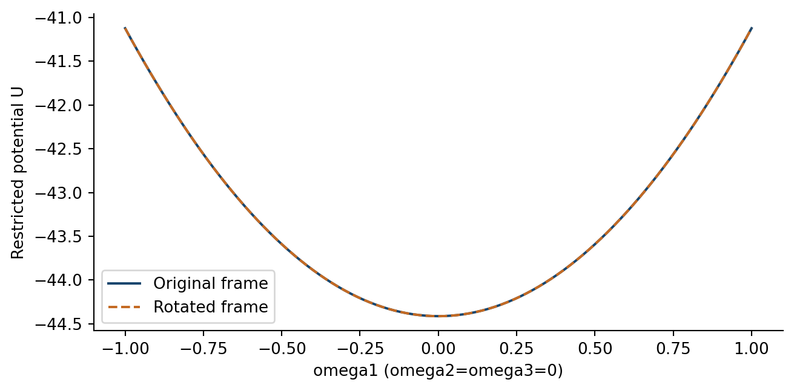
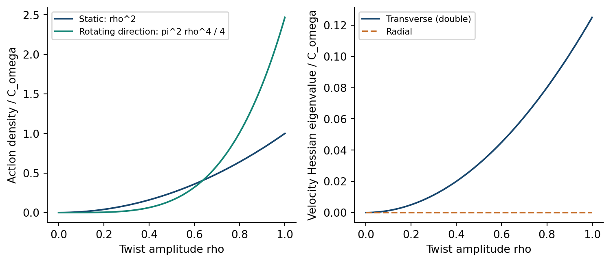

# 4. Spin-1：twist・mixingと四次の微分項

## 静的ベクトル幾何

スカラーとshapeを固定すると、式(M3)のtwist項は $\omega$ について正定値である。round点では各 $(\omega_i,\delta_i)$ 対の静的Hessianは

式(V1)：

$$
H_{\omega\delta}=
\begin{pmatrix}
2\pi^2L^3/(\kappa^2r)&0\\
0&0
\end{pmatrix}.
$$

mixingのflat方向は、指定したcoframe回転に対するscalar作用の独立性を表す。回転後のframeでtorsion成分を改めて指定すると、曲率テンソル全体が一致するとは限らない。scalar作用のflatnessだけで、全てのmixing変分を全場の同時gauge変換と同定するわけではない。

$r=3,L=\kappa=\eta=V=1$ の静的twistポテンシャル。回転前後のcoframeは同じscalar作用を与える。

## 有限振幅の円方向依存

$M=I$ とし、 $r,L,\eta,V$ を固定する。任意の実の滑らかな周期ベクトル $\omega(y)$ に対してQを定義すると、完全な微分を含む計算から次を得る。

式(V2)：

$$
\begin{aligned}
Q&=\lVert\omega\rVert^2\lVert\omega'\rVert^2-(\omega\cdot\omega')^2
=\lVert\omega\times\omega'\rVert^2,\\
R_{\mathrm{LC}}&=\frac{24}{r^2}-\frac{8L^2}{r^4}\lVert\omega\rVert^2
-\frac{2}{r^2}\partial_y(\omega\cdot\omega')
-\frac{L^2}{2r^4}Q.
\end{aligned}
$$

torsion normを固定すると、残るECおよび完全NYの微分寄与は全微分となる。滑らかな周期的mixing回転もこれらの境界currentだけを変える。twistゼロの作用を引くと、exactな制限作用は

式(V3)：

$$
\Delta\mathcal S_\omega=C_\omega\int_0^1dy
\left(\lVert\omega\rVert^2+\frac{Q}{16}\right),
\qquad C_\omega=\frac{\pi^2L^3}{\kappa^2r}>0.
$$

この式は小振幅の四次までの打切りではなく、有限振幅で成立する。微分項は $\omega\mapsto t\omega$ に対して振幅四次であるが、微分そのものは一階微分の二乗である。 $\omega=\rho n,\lVert n\rVert=1$ と書けば $Q=\rho^4\lVert n'\rVert^2$ となり、向きの変化にcostが生じ、大きさだけの変化では消える。速度Hessianは

式(V4)：

$$
G_{ij}(\omega)=\frac{C_\omega}{8}
\left(\lVert\omega\rVert^2\delta_{ij}-\omega_i\omega_j\right).
$$

非零twistではradial固有値が零、横方向の二つの固有値が $C_\omega\lVert\omega\rVert^2/8$ である。twistゼロでは二次の速度行列全体が零になる。このrankは制限Euclidean作用の性質であり、横方向の二成分を物理的な伝播偏極数と数えるものではない。

$\omega=\rho(\cos(2\pi y),\sin(2\pi y),0)$ の静的・微分作用密度と速度Hessian固有値。 $C_\omega$ で正規化した。微分寄与は振幅の四乗で増える。

## この変分族内のtwist停留配置

$E_i=\partial\mathcal L/\partial\omega_i-\partial_y(\partial\mathcal L/\partial\omega_i')$ と置くと、Euler方程式のradial縮約は

式(V5)：

$$
\omega_iE_i=C_\omega\left(2\lVert\omega\rVert^2+\frac{Q}{4}\right).
$$

$Q\ge0$ なので、スカラー固定・round形状のこの族で実twistベクトルを自由に変分すると、停留配置は $\omega=0$ に限られる。これは式(V3)の一意な最小でもある。有限振幅での方向変化のcostと、原点での二次運動項の消失を、一つの変分構造として記述できる。付録Eで式(V2)–(V5)を導き、shapeも変化する際の結合は一般作用(M6)で扱う。

## 向きが変化するshapeとtwistの結合

具体的な同時profileとして $M=\mathrm{diag}(a,b,(ab)^{-1})R_{01}(\vartheta(y))$ 、 $\omega=(0,0,w)$ とし、 $r,L,\eta,V,a,b$ を固定する。 $R_{01}'=R_{01}[\hat e_2]_\times\vartheta'$ の規約では、式(M6)の最後の項から

式(V6)：

$$
\mathcal L_{\mathrm{linear}}
=-\frac{\pi^2Lr}{2\kappa^2}(a^2-b^2)^2\vartheta' w.
$$

$w=0$ でのtwist Euler式には、式(V6)のwの係数が残る。向きの変わる非等方shape履歴を指定すると、この係数は零とは限らない。周期的な $\vartheta$ に対して $\delta w=\vartheta'$ を取れば第一変分は一般に非零であり、この項は周期境界項として捨てられない。twistゼロの停留条件をその指定族に限る結合を具体化した結果であって、全ての共同Euler式の解を構成したものではない。

[前の節・付録](DPPUv2-paper03_sec03.md) / [次の節・付録](DPPUv2-paper03_sec05.md) / [第1節](DPPUv2-paper03_sec01.md)
