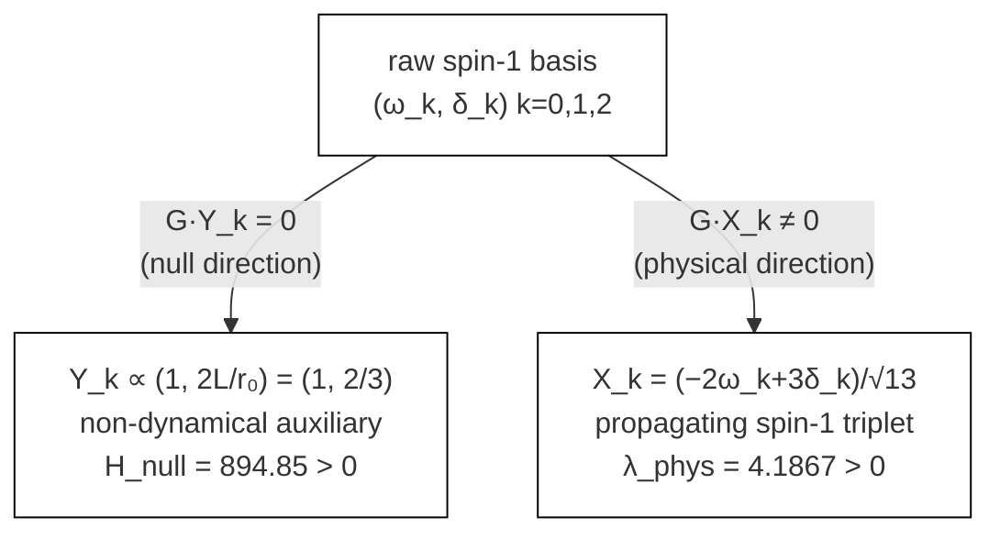
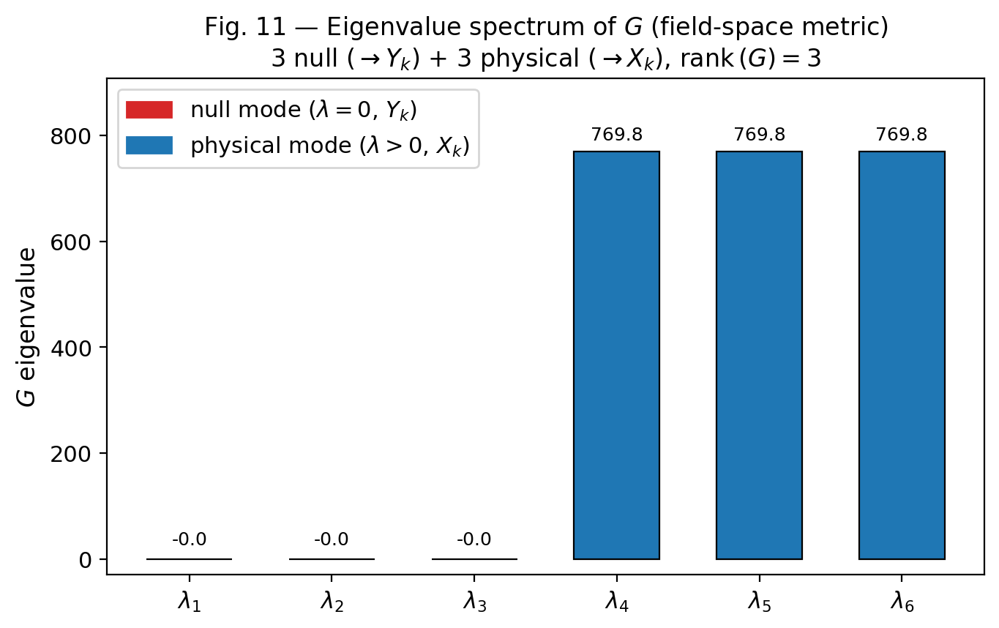
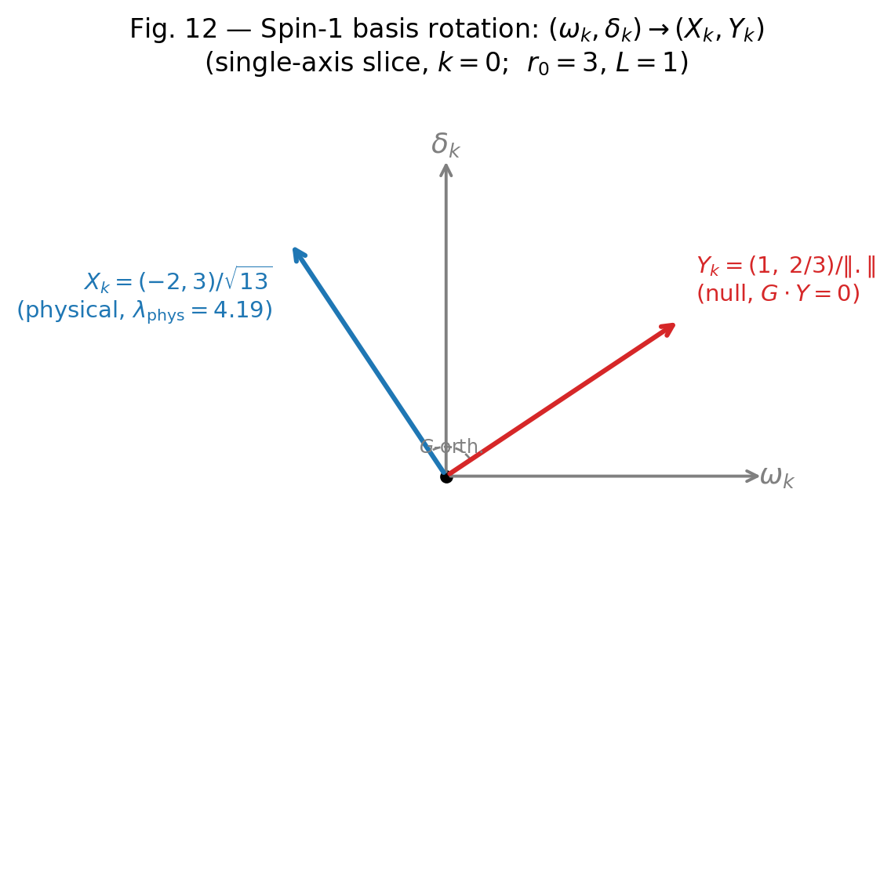

## 5. Spin-1 Sector: Twist-Mixing System and Physical/Auxiliary Decomposition

本節では raw 幾何変数 $(\omega_i,\delta_i)$ を physical basis とする見方を変更し、一般化固有値問題

$$
Hv=\lambda Gv
$$

を基礎として spin-1 セクターを再構成する。結論は、 $Y_k$ は non-dynamical auxiliary、 $X_k$ が唯一の propagating spin-1 triplet、というものである。

### 5.1 Raw spin-1 variables

等方点 $r_0=3,\ L=1$ における raw 2x2 block は

$$
H_2=\begin{pmatrix}
\mu_\omega^2 & m_{\omega\delta}\\
m_{\omega\delta} & \mu_\delta^2
\end{pmatrix}=\begin{pmatrix}
52.6379 & -631.6544\\
-631.6544 & 3789.9295
\end{pmatrix},
$$

$$
G_2=\begin{pmatrix}
G_{\omega\omega} & G_{\omega\delta}\\
G_{\omega\delta} & G_{\delta\delta}
\end{pmatrix}=\begin{pmatrix}
236.870435 & -355.305547\\
-355.305547 & 532.958162
\end{pmatrix}.
$$

raw Hessian 単独の固有値だけを見れば、負方向や不安定性のように見えるものが現れる。しかしこれは physical mass の判定には不十分であり、真に意味を持つのは $H$ と $G$ の対 $(H,G)$ に対する generalized eigenvalue problem である。

### 5.2 Null direction and physical direction

field-space metric $G$ は rank-deficient であり、各軸ごとに null direction

$$
Y_k\propto(\omega_k,\delta_k)=\left(1,\frac{2L}{r_0}\right)=\left(1,\frac23\right)
$$

を持つ。これに直交する physical direction は

$$
X_k=\frac{-2\omega_k+3\delta_k}{\sqrt{13}},
\qquad
k=0,1,2
$$

で与えられる。

ここで $k=0,1,2$ は 3 本の spin-1 軸ラベルであり、空間テンソル指標 $i,j=1,2,3$ とは別物である。さらに $Y_k$ が null になる幾何学的理由は単純である。固定した $k$ に対して、twist $\omega_k$ は $e^k$ に時間方向成分を混入させ、mixing $\delta_k$ は逆に $e^0$ に空間方向成分を混入させる。 $Y_k$ はこの 2 つの変形が metric の二次形式では相殺する方向であり、その結果 $G\,Y_k=0$ が生じる。一方で coframe 変形そのものは消えないので、この方向は gauge ではなく constraint-like auxiliary として残る。

この基底で

$$
G\,Y_k=0,
\qquad
G_{\rm phys}=769.8286\,I_3,
\qquad
H_{\rm phys}=3223.06\,I_3
$$

となり、physical generalized eigenvalue は

$$
\lambda_{\rm phys}=\frac{u^THu}{u^TGu}\bigg|_{u=(-2,3)}=\frac{41899.77}{10007.77}=4.1867>0
$$

である。したがって physical spin-1 triplet は局所的に安定である。

**Fig. 10** Decomposition from raw spin-1 basis to physical/auxiliary basis. The rank-deficiency of $G$ is the origin of the decomposition.

**Fig. 11** Eigenvalue spectrum of the field-space metric $G$ in the spin-1 sector. Three eigenvalues are exactly zero (null directions $Y_k$) and three are degenerate at $G_{\rm phys}=769.83$ (physical directions $X_k$), reflecting the SO(3) Schur structure.

**Fig. 12** Basis rotation from raw spin-1 variables $(\omega_k,\delta_k)$ to physical/auxiliary basis $(X_k,Y_k)$. The null direction $Y_k\propto(1,2L/r_0)$ is identified as a non-dynamical auxiliary; the orthogonal direction $X_k$ carries the propagating spin-1 degree of freedom.

### 5.3 Why $Y_k$ is not gauge

重要なのは、 $Y_k$ を gauge や variable redundancy と取り違えないことである。軸 $k=0$ では、null direction に沿う変分は

$$
\delta e^3_{\rm twist}=+\frac{2L}{r_0}e^0,
\qquad
\delta e^3_{\rm mixing}=-\frac{2L}{r_0}e^0
$$

を与え、合計として $\delta e^3=0$ になる。しかし一方で

$$
\delta e^0=+\frac{2L}{r_0}e^3
$$

が残るため、metric 変分

$$
\delta g_{\tau,\sigma^0}=1\neq0
$$

が生じる。したがってこの方向は gauge ではない。

さらに variable redundancy なら

- $\delta g_{\mu\nu}=0$
- $H_{\rm null}=0$
- 有効固有値 $\lambda_{\rm eff}$ が有限

が必要だが、実際には

$$
H_{\rm null}=894.845>0,
\qquad
\lambda_{\rm eff}\to\infty
$$

である。よって $Y_k$ は kinetic term を持たない補助方向、すなわち non-dynamical auxiliary と解釈するのが正しい。

variable redundancy 排除の詳細（ $\delta g$ の明示的導出、 $H_{\rm null}=894.845>0$ の確認、 $\lambda_{\rm eff}\to\infty$ の計算過程）は Appendix E.4 を参照のこと。

### 5.4 quadratic decoupling

physical spin-1 mode が他 sector と二次レベルで混合するかを全成分で評価したところ、 mixed Hessian は

$$
M_{Ai}^{(qX)}=\frac{\partial^2V}{\partial q_A\partial X_i},
\qquad
M_i^{(rX)}=\frac{\partial^2V}{\partial r\partial X_i},
\qquad
M_i^{(\eta X)}=\frac{\partial^2V}{\partial \eta\partial X_i}
$$

であり、内訳は

- spin-1 x spin-2: 15 成分
- spin-1 x radial: 3 成分
- spin-1 x torsion: 3 成分

の合計 21 成分である。

数値差分評価の結果、

$$
M_{Ai}^{(qX)}=0,
\qquad
M_i^{(rX)}=0,
\qquad
M_i^{(\eta X)}=0
$$

がすべて成立した。step size 安定性の詳細な数値表と偶性確認（ $V(p,+X_k)-V(p,-X_k)=0$ ）は Appendix F.4–F.5 を参照のこと。したがって quadratic decoupling は表示上の丸めではなく、final basis での構造的事実である。

### 5.5 Final quadratic sector for spin-1

以上をまとめると、spin-1 sector の quadratic 寄与は

$$
\mathcal{L}_{X}+\mathcal{L}_{Y}=\frac12 \dot{X}^T G_{\rm phys}\dot{X}-\frac12 X^T H_{\rm phys}X-\frac12 Y^TH_{\rm null}Y
$$

で与えられる。 $Y$ には kinetic term がなく、raw basis で見えていた負方向は physical instability ではない。全 sector を含む完全な $\mathcal{L}_{\rm quad}$ のブロック分解は §6.2 にまとめる。

本節の結論は 以下3 点の通りである。

1. raw basis $(\omega_i,\delta_i)$ はfinal physical basis ではない。
2. $Y_k$ は gauge でも redundancy でもなく non-dynamical auxiliary である。
3. $X_k$ は唯一の propagating spin-1 triplet であり、二次レベルで他 sector と decouple する。
