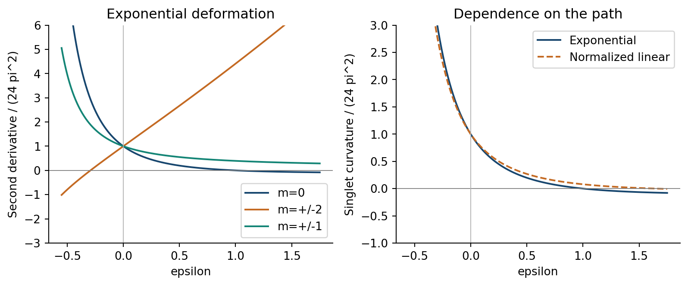
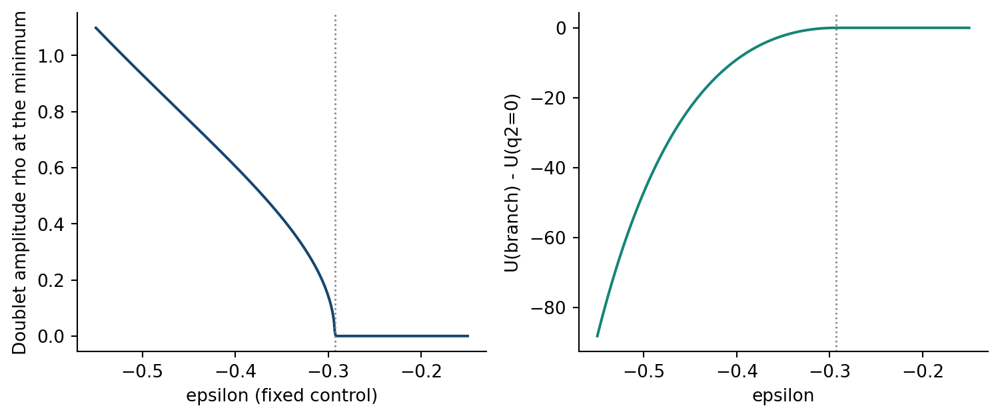
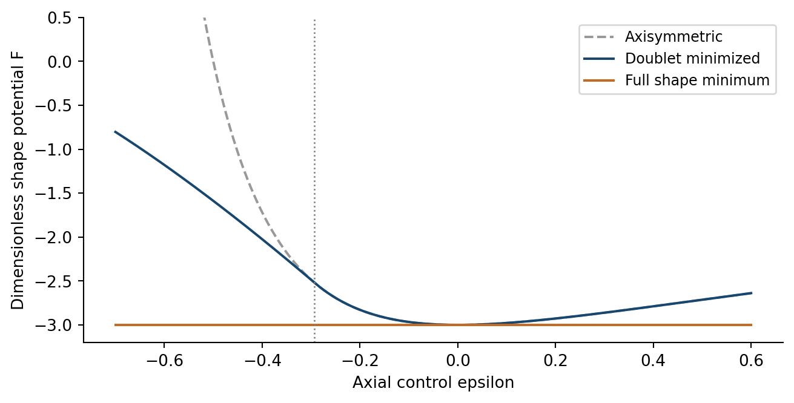

# 5. Spin-2：shape分裂と連続分岐

## 五重項と軸対称背景での分裂

$h=q_AT_A$ とし、 $T_A$ は付録Cの正規直交対称traceless基底とする。 $\omega=0$ ではスカラー制御変数はshape作用に $\mathcal K$ を掛け、shapeに依存しない定数を加える。round点のHessianは $8\mathcal K\delta_{AB}$ となり、正規化した五方向は共通の正の曲率を持つ。軸対称参照 $M_0=\mathrm{diag}(a,a,a^{-2})$ 、 $a=(1+\epsilon)^{1/3},\epsilon>-1$ で、各経路 $M=M_0e^{q_AT_A}$ を用いると、一重項と二つの二重項に分裂する。

式(T1)：

$$
\begin{aligned}
H_0&=\frac{8\mathcal K(4-a^6)}{3a^8},\\
H_2&=\frac{8\mathcal K(2a^6-1)}{a^2},\qquad (T_2,T_3),\\
H_1&=\frac{4\mathcal K(a^6+1)}{a^8},\qquad (T_4,T_5).
\end{aligned}
$$

$a=1$ で三者はround値に一致する。01平面の残余回転は $(T_2,T_3)$ を二倍角、 $(T_4,T_5)$ を同じ角度で回す。二階微分の意味は指数経路を指定することで定まる。shapeの非停留点では、同じ接線を持つ別経路の二階微分が異なり得ることを付録Dで示す。特に $\epsilon=1$ の $H_0=0$ は、その経路に沿う曲率の零点である。

$r=3,L=\kappa=1$ で $24\pi^2$ により正規化した一重項・二重項の曲率。右は軸対称背景で同じ接線を持つ二種類の経路を比較する。

## 軸対称制御変数を固定したdoubletのexact最小化

aを固定し、 $M=M_0\exp(q_2T_2+q_3T_3)$ によりdoublet全体を最小化する。 $\rho=\sqrt{q_2^2+q_3^2}$ とすると、Sの固有値は $a^2e^{\sqrt2\rho},a^2e^{-\sqrt2\rho},a^{-4}$ である。 $z=2\cosh(\sqrt2\rho)\ge2$ を用いると、凸な二次式へ帰着する。

式(T2)：

$$
F(a,z)=a^4(z^2-4)-2a^{-2}z+a^{-8}
=a^4(z-a^{-6})^2-4a^4.
$$

式(T3)：

$$
\begin{aligned}
\rho_{\ast}(a)&=
\begin{cases}
0,&a^6\ge1/2,\\
\mathrm{arcosh}(1/(2a^6))/\sqrt2,&a^6<1/2,
\end{cases}\\
F_{\min}(a)&=
\begin{cases}
a^{-8}-4a^{-2},&a^6\ge1/2,\\
-4a^4,&a^6<1/2.
\end{cases}
\end{aligned}
$$

臨界制御値は $\epsilon_c=1/\sqrt2-1$ である。 $\epsilon<\epsilon_c$ では極小のshape固有値は三つとも異なり、境界で軸対称形状へ連続的に近づく。具体的には、

式(T4)：

$$
\begin{aligned}
\rho_{\ast}&=2^{3/4}\sqrt{\epsilon_c-\epsilon}
+O((\epsilon_c-\epsilon)^{3/2}),\\
[\thinspace \partial_\epsilon^2 F_{\min}\thinspace ]_{\mathrm{right}}
-[\thinspace \partial_\epsilon^2 F_{\min}\thinspace ]_{\mathrm{left}}
&=32\thinspace 2^{1/3}.
\end{aligned}
$$

$F_{\min}$ とその一次微分は $\epsilon_c$ で連続である。臨界点の $\rho^4$ 係数は $2\thinspace 2^{1/3}>0$ となる。これは制限された形状極小の連続分岐、すなわちこの有限次元の最小化問題内での連続的な形状転移を特徴付ける。

軸対称制御変数固定でのdoublet振幅とポテンシャルの減少量。点線は $\epsilon_c$ 。非零振幅の極小は回転軌道をなし、孤立した二点ではない。

断面 $q_3=0$ の $q_2$ の正負二枝は、円 $q_2^2+q_3^2=\rho_{\ast}^2$ 上の点である。残余 $SO(2)$ 回転がこの円を結ぶ。回転・軸の名前替えで結ばれる形状を同一視すると、固定した制御値ごとに一つの三軸不等shapeの類となる。

## 静的shapeポテンシャルの大域最小

スカラー制御変数を固定しtwistをゼロとすると、行列式1の任意の正定値Sは、軸の順序を選べば式(T2)で用いた固有値表示を持つ。従って式(T3)を $a>0$ についても最小化すれば、回転を除いた全shapeを扱える。 $a^6<1/2$ では $F_{\min}>-2^{4/3}>-3$ であり、残る枝では

式(T5)：

$$
F_{\min}+3=
\frac{(a^2-1)^2(3a^4+2a^2+1)}{a^8}\ge0.
$$

等号は $a=1,z=2$ 、従って $S=I$ に限られる。このtwistゼロの断面では、round形状が静的ポテンシャルの回転を除いて一意な大域最小shapeとなる。式(M3)のtwist項は非負なので、twistも最小化すれば $\omega=0$ となる。非零のtwistを指定して固定する場合は、式(M3)の最後の項のshape依存性により、shape極小は一般に移動する。上記の固定制御値での分岐と全shape最小は、静的なtwistゼロのポテンシャルの相補的な二つの結果である。torsionと円周を固定すると、この下限と第3節の結果を合わせ、 $V\ne0,\eta^2<4$ の場合にroundな半径極小も得られる。

軸対称shapeポテンシャル、doubletを最小化した値、全shapeの下限 $F=-3$ 。軸対称制御変数も解放すると $\epsilon=0,\rho=0$ が選ばれる。

## 円方向に変化するshape

$\omega=0$ 、 $B=M^{\mathsf T}M$ 、 $\det B=1$ と置くと、 $Y=0$ 、 $\mathrm{tr}(B^{-1}B')=0$ である。式(M6)の微分部分は

式(T6)：

$$
\mathcal L_{\partial}\big|_{\omega=0}
=-\frac{3\pi^2r(r')^2}{4\kappa^2L}
+\frac{\pi^2r^3}{32\kappa^2L}
\mathrm{tr}\left[(B^{-1}B')^2\right].
$$

$B^{-1}B'$ は対称行列 $B^{-1/2}B'B^{-1/2}$ と相似なので、shape項は非負である。一定round参照点近傍で $M=e^h$ とすると、二次項は $\pi^2r_0^3\mathrm{tr}[(h')^2]/(8\kappa^2L_0)$ となる。twistゼロではscalar–shapeの微分交叉項は厳密に消える。静的分岐と正のshape微分costを同じセクターで記述でき、非零twistへの拡張には第6節の連成項を用いる。

[前の節・付録](DPPUv2-paper03_sec04.md) / [次の節・付録](DPPUv2-paper03_sec06.md) / [第1節](DPPUv2-paper03_sec01.md)
