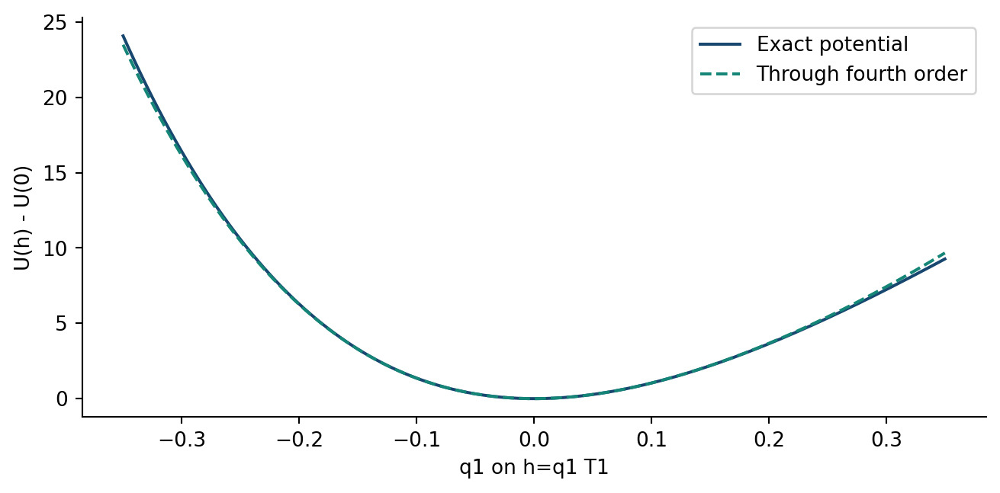
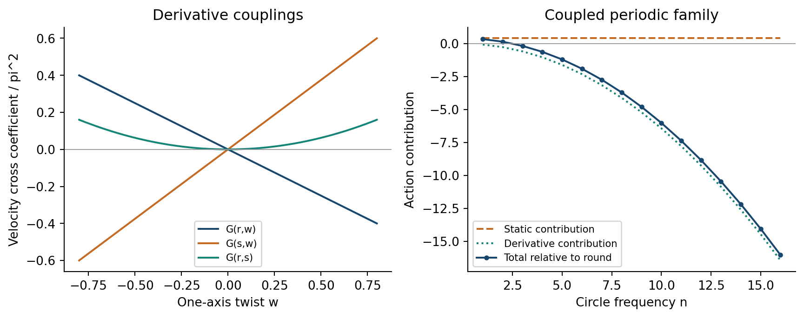
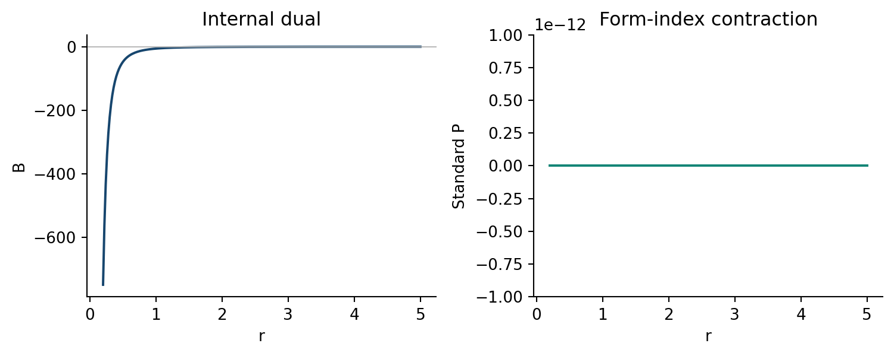

# 6. 相互作用・連成profile・曲率恒等式

## 既約セクター間の相互作用

$M=e^h$ に対して $I_2=\mathrm{tr}(h^2),I_3=\mathrm{tr}(h^3)$ と定義する。Cayley–Hamiltonにより $\mathrm{tr}(h^4)=I_2^2/2$ である。exactポテンシャルの展開は

式(I1)：

$$
\begin{aligned}
F(e^{2h})&=-3+4I_2+\frac{40}{3}I_3+\frac{14}{3}I_2^2+O(h^5),\\
\lVert e^h\omega\rVert^2&=\omega^2+
2\omega^{\mathsf T}h\omega+2\omega^{\mathsf T}h^2\omega
+O(h^3\omega^2).
\end{aligned}
$$

第一行には $\mathcal K$ 、第二行には $\mathcal K L^2/r^2$ を掛ける。これにより、各セクターと同じ正規化でtensor自己相互作用とtensor–twist結合が得られる。一般には三次tensor不変量が存在する。doubletの振幅ポテンシャルが偶関数であることは指定断面の性質であり、全モデルの $h\mapsto-h$ 対称性ではない。表現論が許す不変量を整理し、実際の係数を作用から定める。付録Gに展開と二次blockとの関係を示す。

$h=q_1T_1$ に沿うexact shapeポテンシャル差と四次までの不変量展開。 $r=3,L=\kappa=\eta=V=1$ を固定した。

## 微分交叉項

一般作用は、一定round・twistゼロの参照点で二次の分離を保つ。各摂動とその微分を一次として数えると、異なるセクターを結ぶ代表的な三次項は

式(X1)：

$$
\begin{aligned}
\mathcal L_{\mathrm{cross}}^{(3)}
={}&-\frac{\pi^2L_0}{2\kappa^2}\delta r'\thinspace \omega^{\mathsf T}\omega'
+\frac{\pi^2L_0r_0}{4\kappa^2}\omega'^{\mathsf T}h'\omega\\
&-\frac{\pi^2L_0r_0}{\kappa^2}
\mathrm{tr}\left[h'\left(h[\omega]_\times-[\omega]_\times h\right)\right].
\end{aligned}
$$

最初の二項は速度交叉項、最後はshift結合の先頭項である。スカラーに依存する係数の展開からも頂点が生じ、全て式(M6)に含まれる。有限振幅の具体例として $M=\mathrm{diag}(e^s,e^{-s},1)$ 、 $\omega=(w,0,0)$ とし、 $\mathsf G_{ab}=\partial^2\mathcal L_\partial/\partial x_a'\partial x_b'$ と定義すると、

式(X2)：

$$
\begin{aligned}
\mathsf G_{rw}&=-\frac{\pi^2Lw}{2\kappa^2e^{2s}},&
\mathsf G_{sw}&=\frac{\pi^2Lrw}{4\kappa^2e^{2s}},&
\mathsf G_{rs}&=\frac{\pi^2Lw^2}{4\kappa^2e^{2s}},\\
\mathsf G_{rL}&=-\frac{\pi^2w^2}{2\kappa^2e^{2s}},&
\mathsf G_{sL}&=\frac{\pi^2rw^2}{4\kappa^2e^{2s}}.
\end{aligned}
$$

非零twistでは交叉項が残る。速度Hessianには速度一次項(V6)が含まれないため、Euler式ではそれも保持する。一般の速度rankと物理的自由度数との区別は付録Jに示す。

## 連成周期族と作用の非有界性

上の対角族で $r,L,\eta,V$ を固定すると、微分密度は厳密に平方完成できる。

式(X3)：

$$
\begin{aligned}
\mathcal L_{\partial}
&=\frac{\pi^2r^3}{4\kappa^2L}(s')^2
+\frac{\pi^2Lr}{4\kappa^2e^{2s}}s'ww'\\
&=\frac{\pi^2r^3}{4\kappa^2L}
\left(s'+\frac{L^2ww'}{2r^2e^{2s}}\right)^2
-\frac{\pi^2L^3w^2(w')^2}{16\kappa^2r e^{4s}}.
\end{aligned}
$$

shapeを固定した一軸twistの微分costは零であるが、shapeをtwistに連成させると第二項の負の寄与が生じる。次の滑らかで周期的な非退化族を取る。

式(X4)：

$$
\begin{aligned}
w_n(y)&=A\cos(2\pi n y),\quad
e^{2s_n}=1-\frac{L^2w_n^2}{2r^2},
\quad 0<A<\frac{\sqrt2r}{L},\quad n=1,2,\ldots,\\
\mathcal S_n&=\overline U_A-n^2C_A,\qquad
C_A=\frac{\pi^2L^3}{16\kappa^2r}
\int_0^1\frac{w_1^2(w_1')^2}{[1-L^2w_1^2/(2r^2)]^2}\thinspace dy>0.
\end{aligned}
$$

$s_n$ の関係式により式(X3)の平方項は零になる。各profileは同じ経路をn回繰り返すので、静的平均 $\overline U_A=\int_0^1U(r,L,\eta,V,M_n,\omega_n)\thinspace dy$ はnによらず、微分寄与は $-n^2$ に比例する。従って $\mathcal S_n\to-\infty$ である。高階微分項や周波数制限を加えない本モデルでは、スカラー固定でも同時profileのEuclidean作用は下に有界でない。この非有界性は、拘束条件を課す前のEuclidean作用を、指定した滑らかな周期profile上で評価した結果である。

負の寄与には幾何学的な由来がある。 $\widetilde X=X-\tfrac13(\mathrm{tr}X)I$ と置くと、式(M6)の速度二次形式は $\mathrm{tr}(\widetilde X^2)-\tfrac23(\mathrm{tr}X)^2$ であり、 $\mathrm{tr}X=(\ln\det\gamma)'$ は誘導された空間体積の変化を表す。 $r$ と $L$ を固定してもこの体積は固定されない。式(X4)に沿って $\det\gamma=r^6(1+L^2w_n^2e^{-2s_n}/r^2)$ はtwistとともに変化し、 $w_nw_n'\ne0$ の点ではtrace項が勝る。式(S4)の負の半径微分項も同じtrace方向に由来する。従ってこの系列は、Euclidean重力作用の共形モードに沿う不定性 [7] を、スカラー固定のもとでshape–twist結合を通じて実現している。

左： $r=3$ 、 $L=\kappa=1$ 、 $s=0$ における式(X2)の速度交叉係数。右： $A=0.5$ 、 $\eta=V=1$ での式(X4)の作用寄与をround静的配置との差で示す。静的寄与は周波数によらず、連成微分寄与は $-n^2$ に比例して減少する。

このパラメータでround静的作用は $-44.4132198049$ 、連成作用は $n=1$ で $-44.0662455826$ 、 $n=4$ で $-45.0308924809$ 、 $n=8$ で $-48.1177625553$ となる。第5節の静的な大域shape下限と、円方向作用汎関数の下限が存在しないことは、異なる対象を異なる変分族で最小化する結果として両立する。

## 完全NYとform添字のPontryagin

添字対の交換対称性を仮定せず、完全なEC曲率を用いて密度を定義する。

式(I2)：

$$
\begin{aligned}
N&=\frac14\epsilon^{abcd}T^e{}_{ab}T_{ecd}
-\frac12\epsilon^{abcd}R_{abcd},\\
P&=\frac14\epsilon^{cdef}R_{abcd}R_{abef},\qquad
P\thinspace \mathrm{vol}_4=\sum_{a,b}R_{ab}\wedge R_{ab},\\
B&=\sum_{c<d}\left(R_{01cd}R_{23cd}-R_{02cd}R_{13cd}
+R_{03cd}R_{12cd}\right).
\end{aligned}
$$

向き付けた四次元unimodular Lie代数上の一定接続では、全ての左不変三形式が閉じる。三形式を $\iota_X\mathrm{vol}$ と書けば、その外微分は $\mathcal L_X\mathrm{vol}$ となり、unimodularityによって零となる。NY三形式と接続のChern–Simons三形式（その外微分がRiemann–Cartan空間での二つの不変量を与える [5]）はいずれも左不変なので、

式(I3)：

$$
\begin{aligned}
N\thinspace \mathrm{vol}_4&=d(e^a\wedge T_a)=0,\\
P\thinspace \mathrm{vol}_4&=-d\thinspace \mathrm{tr}
\left(\Gamma\wedge d\Gamma+\frac23\Gamma\wedge\Gamma\wedge\Gamma\right)=0.
\end{aligned}
$$

第二行の $\Gamma$ は行列値接続一形式を表す。定理はAX・VT・MX、および $S^3\times S^1$ の任意の一定coframe変形を含む。これは局所代数的な結果であり、compact性は積分領域を与える。内部双対量Bは別の縮約であり、非零となり得る。付録Bには独立な正規化と、接続が一定でなく $P\ne0$ となる例を示す。

$\eta=V=1$ のround MX族における内部双対Bと標準form添字P。Pは解析的に零であり、描画値は浮動小数点の残差を示す。

[前の節・付録](DPPUv2-paper03_sec05.md) / [次の節・付録](DPPUv2-paper03_sec07.md) / [第1節](DPPUv2-paper03_sec01.md)
