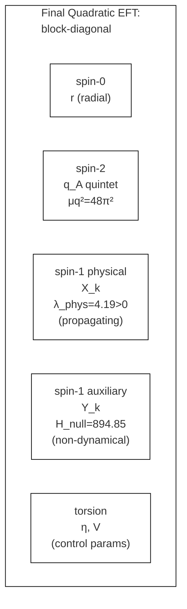
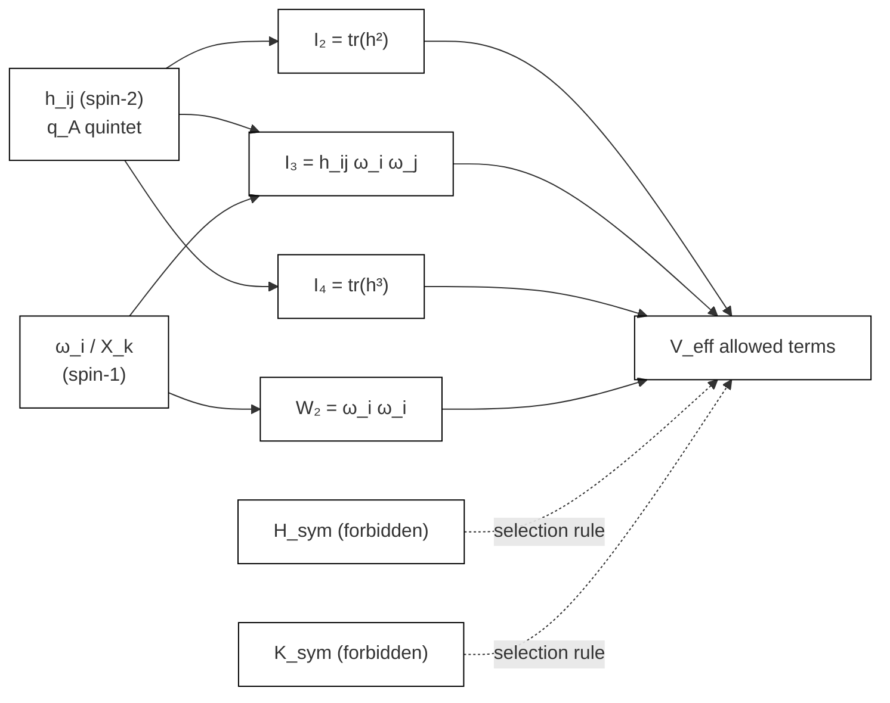
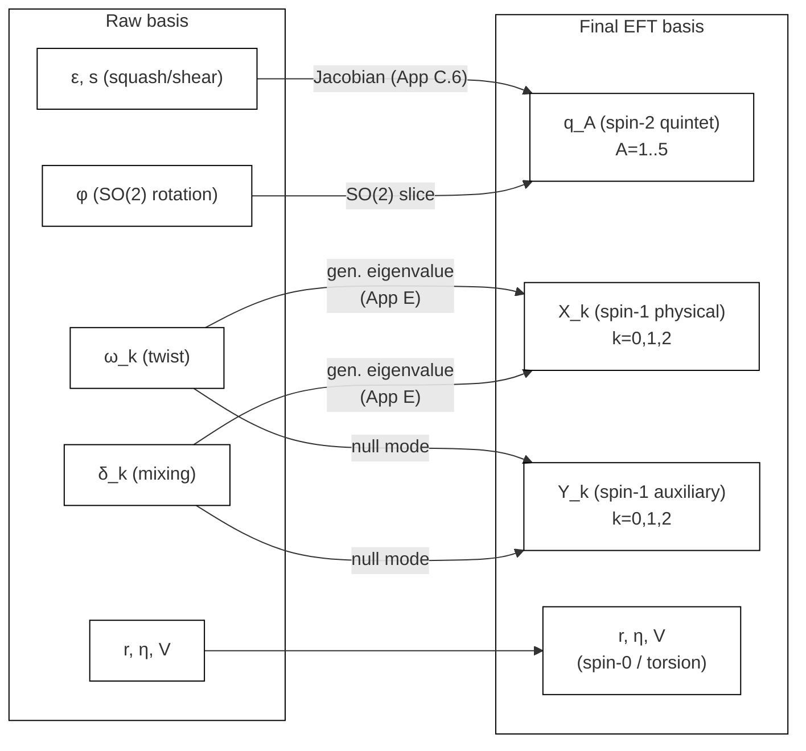

## 6. Unified Geometric Landau EFT

本節では、§3 - §5 の結果を一つの最終有効理論としてまとめる。要点は、final basis では二次 sector が block-diagonal に整理され、低次不変量によって許容される相互作用項が明確になることである。

### 6.1 Raw quadratic data

raw basis では有効ポテンシャルは

$$
V_{\rm eff}=
V_0+
\frac12\mu_q^2\,{\rm tr}(h^2)+
\frac12\mu_\omega^2|\omega|^2+
\frac12\mu_\delta^2|\delta|^2+
m_{\omega\delta}\,\omega\cdot\delta+
c_\omega\,h_{ij}\omega_i\omega_j+
c_\delta\,h_{ij}\delta_i\delta_j+
O(4)
$$

と書ける。ここで

$$
\mu_q^2=48\pi^2,\qquad
\mu_\omega^2=52.6379,\qquad
\mu_\delta^2=3789.9295,\qquad
m_{\omega\delta}=-631.6544,
$$

$$
c_\omega=105.28,\qquad
c_\delta=1894.96,\qquad
c_{\omega\delta}=0\quad\text{(等方点)}
$$

である。

raw 幾何変数での記述は幾何的な由来の確認には必要だが、物理的な自由度の整理としては過剰である。§5 の physical / auxiliary 分解により、final basis を導出する。

### 6.2 Final quadratic EFT

final basis では、quadratic sector は概念的に

$$
\mathcal{L}_{\rm quad}=
\mathcal{L}_{r}+\mathcal{L}_{q_A}+\mathcal{L}_{X}+\mathcal{L}_{Y}+\mathcal{L}_{\eta,V}
$$

と block-diagonal に分解される。より具体的には

$$
\mathcal{L}_{q_A}=-\frac12\mu_q^2\sum_{A=1}^5 q_A^2,
\qquad
\mathcal{L}_{X}=\frac12\dot{X}^T G_{\rm phys}\dot{X}-\frac12 X^T H_{\rm phys}X,
\qquad
\mathcal{L}_{Y}=-\frac12 Y^TH_{\rm null}Y
$$

である。

$X_k$ と $(q_A,r,\eta)$ の mixed Hessian が全 21 成分でゼロと確認されたため、spin-1 sector の quadratic decoupling は final basis において厳密な statement である。また、spin-2 sector と torsion 変数 $(\eta,V)$ の間の cross-Hessian も全 10 成分でゼロと確認され、さらに radial– $V$ cross-Hessian もゼロである。ただし、radial– $\eta$ cross-Hessian は非ゼロ（ $\approx 118.4$ ）であり、spin-0/torsion subsector は $(r,\eta)$ 混合ブロックを形成する。したがって local stability の議論は、spin-2・spin-1 各 block については独立に行うことができるが、scalar/torsion subsector は $(r,\eta)$ を連立して扱う必要がある。

**Fig. 13** Quadratic block organization of the final sector. The spin-1 sector fully decouples; the spin-2 sector decouples from torsion; the scalar/torsion subsector contains a coupled $(r,\eta)$ block.

### 6.3 Invariant basis and selection rules

Landau-EFT の低次スカラーは、最終的に

$$
I_2={\rm tr}(h^2),\qquad
I_3=h_{ij}\omega_i\omega_j,\qquad
I_4={\rm tr}(h^3),\qquad
W_2=\omega_i\omega_i
$$

を基底として整理される。exact check により

$$
I_3=q_A F_A(\omega)
$$

が最終 $T_A$ 基底で成立することが確認されている。quartic order では

$$
I_2^2,\qquad I_2W_2,\qquad W_2^2
$$

が補助基底として自然に現れる。

この整理により、

- 許容される代表的 cubic term は $h_{ij}\omega_i\omega_j$ と $h_{ij}\delta_i\delta_j$
- final basis では $X_k$ を用いた quadratic cross-term は消滅
- 既知の禁制項 $H_{\rm sym}$、 $K_{\rm sym}$ は表現論的選別則によって排除

という形で、interaction structure が見通しよく記述できる。

**Fig. 14** Connection structure of low-order invariants in the Landau-EFT. Solid arrows: allowed terms; dashed arrows: terms forbidden by selection rules.

### 6.4 Final dictionary

本論で採用する mode dictionary を再掲する。

| variable | final classification | role | comment |
|---|---|---|---|
| $r$ | spin-0 | isotropic radius | equilibrium value $r_0=3$ |
| $q_A$ | spin-2 | full shear quintet | $\mu_q^2=48\pi^2$ |
| $X_k$ | spin-1 physical | propagating mixed mode | quadratic decoupled |
| $Y_k$ | spin-1 auxiliary | non-propagating auxiliary | not gauge |
| $\eta$ | spin-0 torsion | AX parameter | input / control |
| $V$ | spin-0 torsion | VT parameter | input / control |

raw 幾何変数 $(\omega_i,\delta_i)$ は、あくまで intermediate description であり、最終的な物理辞書では $X_k$ と $Y_k$ に読み替えられる。

quadratic sector のブロック分解は §6.2 で示した通りであり、spin-1 および spin-2 sector は decouple する一方、scalar/torsion subsector は §6.2 で同定した連立 $(r,\eta)$ ブロックを保持する。

**Fig. 15** Overall transformation from raw geometric variables to the final EFT basis. Arrows indicate the assignment of each variable.

### 6.5 Interpretation as a geometric Landau EFT

以上の結果から本モデルを、単なる重力 minisuperspace における数値ポテンシャルの記述としてではなく、有限自由度の geometric Landau-EFT として理解することができるようになる。ここでは

1. order parameter に相当する幾何自由度が既約表現で整理される。
2. 二次 sector は表現論的ブロックに整理できる。spin-1 sector は完全に decouple し、scalar/torsion 側は連立 $(r,\eta)$ ブロックと独立な $V$ 方向という精密化されたブロック構造をもつ。
3. 許容 interaction は不変量基底と表現論的選別則で記述できる。

本節は、この意味で minisuperspace 還元の $S^3 \times S^1$ トポロジーにおける幾何自由度の振る舞いを「統一された理論言語」に翻訳する役割を担っている。

§6.2 の cross-Hessian 解析により、このブロック整理が quadratic order で厳密であることが確認されている（数値表の詳細は Appendix H.3 を参照）。加えて、torsion block $H^{(\eta,V)}$ は等方点で対角かつ 2 重縮退であり固有値は正（ $\approx 355.3$ ）である一方、連立 $(r,\eta)$ 2×2 ブロックは AX モードで鞍点型（indefinite）となり、 $r$ の零モード性を反映して $\lambda_{\min} < 0$ となる。
